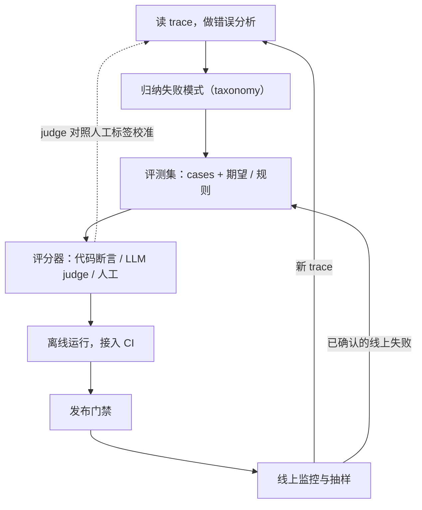
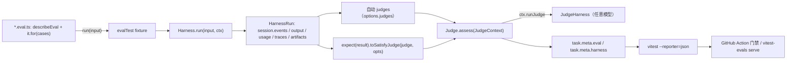

# LLM 应用评测：工业界怎么做、用什么框架、怎样自己搭

> 检查日期：2026-10-20。
>
> 范围：只讨论 LLM 应用和业务场景的评测，贯穿全文的三个例子是 RAG 问答、带工具调用的多轮 agent、结构化抽取/分类。不讨论 benchmark、排行榜和论文式的模型评测。tau-bench / tau2-bench 只作为方法论出现（模拟用户、终态检查），不引用任何分数。
>
> 证据约定：带链接的句子是来源本身的说法，链接都是调研过程中在检查日实际打开过的页面。标「本文归纳」的是本文自己的综合判断，没有单一来源直接这么说。核实不了的地方直接写「未核实」。GitHub stars 取自仓库网页上显示的四舍五入值，因为本次会话里 GitHub REST API 被代理拒绝（403）。
>
> 怎么读：只想要答案，看「先说结论」、第 6 节（现成框架）和第 10 节（自己搭）；想弄懂评测的算法部分，看第 3 节；想看别人的代码怎么组织，看第 7-9 节。

## 先说结论

- **团队怎么做**。本文归纳：几乎所有一手来源都不是先挑指标，而是先读真实 trace（一次请求的完整记录：输入、检索结果、工具调用、输出）、做错误分析。然后把发现的失败模式写成一条条二元 pass/fail 检查，能用代码判断的就用代码，只有需要「判断力」的才交给 LLM judge，而且这个 judge 要像分类器一样，先对照人工标签验证再用（[Hamel & Shreya FAQ](https://hamel.dev/blog/posts/evals-faq/)、[Anthropic](https://www.anthropic.com/engineering/demystifying-evals-for-ai-agents)、[Eugene Yan](https://eugeneyan.com/writing/product-evals/)、[Shopify](https://shopify.engineering/building-production-ready-agentic-systems)）。
- **多轮 agent**。常见做法是用另一个 LLM 扮演用户，对着可重置的业务后端跑对话，结束后检查数据库终态，同一任务重复多次看稳定性（pass^k）（[Sierra tau-bench](https://sierra.ai/blog/benchmarking-ai-agents)、[Anthropic](https://www.anthropic.com/engineering/demystifying-evals-for-ai-agents)、[Intercom](https://www.intercom.com/blog/announcing-evals-and-releases/)）。
- **用什么框架**。GitHub 明说「we generally build our own evaluation tools」（[GitHub](https://github.blog/ai-and-ml/generative-ai/how-we-evaluate-models-for-github-copilot/)）。Anthropic 说很多团队组合多个工具、自写框架或只用简单脚本，但它给的建议是「It's often best to quickly pick a framework that fits your workflow, then invest your energy in the evals themselves」（[Anthropic](https://www.anthropic.com/engineering/demystifying-evals-for-ai-agents)）。平台（Langfuse、Arize Phoenix、Opik、LangSmith、Braintrust）主要承担线上 trace、打分和标注这一半。
- **有没有现成框架**。有。离线 runner 的主流是 [promptfoo](https://github.com/promptfoo/promptfoo)（YAML 声明矩阵 + 断言 + CI 门禁）和 [DeepEval](https://github.com/confident-ai/deepeval)（pytest 风格 + 大量内置指标）。**最像 pi 的是 Sentry 的 [vitest-evals](https://github.com/getsentry/vitest-evals)**：它是 Vitest 上薄薄的一层，pi 自己的评测套件就用它（[pi packages/evals/package.json](https://github.com/earendil-works/pi/blob/a731ba8b80ac56662b4ca7f09102f94447862d8c/packages/evals/package.json)）。Python 侧最接近的是 [Pydantic Evals](https://github.com/pydantic/pydantic-ai)。
- **框架不是重点**。Anthropic 原话是框架「only as good as the eval tasks you run through them」（[Anthropic](https://www.anthropic.com/engineering/demystifying-evals-for-ai-agents)）；Hamel 和 Shreya 自述 60-80% 的开发时间花在错误分析和评测上（[FAQ](https://hamel.dev/blog/posts/evals-faq/)，作者个人经验，不是普遍统计）。
- **pi 式的东西长什么样**。本文归纳：一个评测框架只需要五个原语，即 case、task（被测系统）、grader、runner、report；结果是能 diff 的 JSONL 文件。精读 vitest-evals 和 promptfoo 时各写过一份约百行的核心循环草稿，第 10 节把两者的思路合并成一个能运行的 Python 骨架。
- **自己搭从哪开始**。本文归纳：day 0 先写 20-50 个用例、配代码断言、用一个百行脚本跑；有了日志就做错误分析，为每个需要判断的失败模式建一个二元 judge 并校准；上线后接 trace 平台做抽样在线评估，把线上失败回灌到回归集。如果是 TypeScript 应用并且想要现成的，直接用 vitest-evals；如果需要非工程师也能写用例、或者要大量现成断言，用 promptfoo。

## 1. 评测是一个闭环



本文归纳，每一步一句话：

- **错误分析**：读真实或模拟的 trace，用自由文本记下「哪里不对」（[FAQ](https://hamel.dev/blog/posts/evals-faq/)）。
- **失败模式**：把笔记归并成分类，按频率和影响排优先级。评测要测的就是这些，而不是通用的「有用性」。
- **评测集**：每个失败模式对应若干 case，写清输入和判定规则。
- **评分器（grader）**：给一次输出打分的那段逻辑。一个失败模式一个 grader。
- **离线运行 / CI**：每次改 prompt、模型或检索参数都跑一遍，和基线比。
- **发布门禁**：事先定好的通过条件，例如「缺陷率置信区间上界低于 5%」。
- **线上监控**：对生产 trace 抽样，异步跑不需要参考答案的 evaluator，再交人工看。新失败一方面回到错误分析，另一方面直接进回归集。

## 2. 工业界怎么做

下面按跨来源反复出现的做法组织，每条都标了出处。

### 2.1 从真实失败出发，小样本起步

- Anthropic 建议从 20-50 个来自真实失败（手工发布前检查、bug tracker、客服工单）的简单任务开始，理由是早期改动效果大，小样本就够看出差异（[Anthropic](https://www.anthropic.com/engineering/demystifying-evals-for-ai-agents)）。
- Hamel 和 Shreya 的做法叫错误分析：维护一个约 100 条多样 trace 的池子，自己先标至少 30 条，再让 LLM 帮忙归类（[FAQ](https://hamel.dev/blog/posts/evals-faq/)）。
- Shopify 放弃了人工精选的「golden」数据集，改为从真实商家对话里抽样的 Ground Truth Sets（GTX），评判标准也从实际观察中来，而不是从需求文档来（[Shopify](https://shopify.engineering/building-production-ready-agentic-systems)）。
- Intercom 的模拟对话可以直接从真实收件箱对话生成（[Intercom](https://www.intercom.com/blog/announcing-evals-and-releases/)）；OpenAI 建议开发期「log everything」，以后从日志里挖用例（[OpenAI](https://developers.openai.com/api/docs/guides/evaluation-best-practices)）。

### 2.2 二元判定，一个检查一个评分器，全部通过才算过

- Hamel 和 Shreya 主张二元 pass/fail 而不是 1-5 分的 Likert 量表，多个检查合成「全部通过率」再下钻，而不是加权综合分（[FAQ](https://hamel.dev/blog/posts/evals-faq/)）。
- Eugene Yan 反对一个评估器同时评 5-10 个维度的「God Evaluator」，主张每个维度一个评估器，再用「全部通过才算通过」这类简单规则组合（[Eugene Yan](https://eugeneyan.com/writing/product-evals/)）。
- Intercom：「if any single criterion fails, the Simulation fails」（[Intercom](https://www.intercom.com/blog/announcing-evals-and-releases/)）。Shopify 明确反对「Rate this 0-10」这种「Vibe LLM Judge」（[Shopify](https://shopify.engineering/building-production-ready-agentic-systems)）。OpenAI 的理由是「LLMs are better at discriminating between options」，所以优先 pass/fail 或成对比较（[OpenAI](https://developers.openai.com/api/docs/guides/evaluation-best-practices)）。

### 2.3 先用代码断言，只在需要判断时用 LLM judge

- Anthropic 把 grader 分三类：代码（字符串匹配、单元测试、终态与工具调用检查）、模型（rubric、成对比较、参考答案对照）、人工；代码 grader 快、便宜、可复现（[Anthropic](https://www.anthropic.com/engineering/demystifying-evals-for-ai-agents)）。
- Hamel 和 Shreya：能用确定性规则抓住的失败（JSON 能否解析、工具参数是否正确）就写断言，LLM judge 只给需要判断力的失败模式（[FAQ](https://hamel.dev/blog/posts/evals-faq/)）。
- GitHub Copilot 的代码评测靠执行测试判分；聊天评测里简单的真/假题自动判，复杂回答才交给另一个 LLM，团队再审计 judge 的输出（[GitHub](https://github.blog/ai-and-ml/generative-ai/how-we-evaluate-models-for-github-copilot/)）。

### 2.4 LLM judge 是一个要验证的分类器

LLM-as-judge 指用一个 LLM 按给定标准判断另一个 LLM 的输出。来源一致的做法是：先让人标一批数据，再看 judge 和人的一致程度，达标才用。

- Hamel 和 Shreya：每个失败模式标 100-200 条，分 train/dev/test，分别报告两种正确率（定义见 3.5 节）（[FAQ](https://hamel.dev/blog/posts/evals-faq/)）。
- Eugene Yan：约 75% dev / 25% 留出 test，看评估器在「失败」类上的 precision 和 recall，以及 Cohen's kappa（一种扣除了偶然一致的一致性系数，1 是完全一致，0 相当于随机）（[Eugene Yan](https://eugeneyan.com/writing/product-evals/)）。
- Shopify：每段对话至少 3 名产品专家标注，用 Cohen's kappa、Kendall tau、Pearson 衡量一致性；judge 经过多轮 prompt 迭代，kappa 从 0.02 提到 0.61，人与人之间的基线是 0.69。接受标准是把 judge 随机换进专家组替掉一个人，当分不出用的是人还是 judge 时就信任它（[Shopify](https://shopify.engineering/building-production-ready-agentic-systems)）。

本文归纳：人与人的一致程度是 judge 的天花板，不是 100%。

### 2.5 多轮 agent：模拟用户 + 终态检查 + 重复运行

- Sierra 的 tau-bench：环境 = 数据库 + 工具 API + 业务政策文档 + 一个按场景说明扮演用户的 LLM；成功与否靠「compares the database state after each task completion with the expected outcome」判定，不需要 judge（[Sierra](https://sierra.ai/blog/benchmarking-ai-agents)）。
- Anthropic 推荐对话型 agent 用「可验证的终态 + 评沟通质量的 rubric」，通常配一个模拟用户的 LLM，成功是多维的，例如「工单已解决（状态检查）、10 轮内完成（transcript 约束）、语气得当（LLM rubric）」。但它也说实践中对话型 agent 评测「typically use model-based graders to assess both communication quality and goal completion」，因为很多任务有多种正确解（[Anthropic](https://www.anthropic.com/engineering/demystifying-evals-for-ai-agents)）。所以「以终态为主评分器」是 tau 系列的做法；没有状态可查时，目标完成度也常由 LLM 判。
- Shopify 用 LLM 商家模拟器抓取真实对话的目标，再拿候选系统重放（[Shopify](https://shopify.engineering/building-production-ready-agentic-systems)）。Hamel 和 Shreya 另给一条路：N-1 测试，即拿真实对话前 N-1 轮当输入，只检查第 N 轮，他们认为它「often works better」（[FAQ](https://hamel.dev/blog/posts/evals-faq/)）。
- DoorDash 据 InfoQ 的二手报道也是类似做法：LLM 扮演顾客、场景来自历史对话、订单与退款 API 被 mock、按失败模式的 judge 对照人工校准（[InfoQ](https://infoq.com/news/2026/03/doordash-llm-chatbot-simulator/)）。DoorDash 原文返回 HTTP 403，未核实。

### 2.6 流水线分组件评，端到端为准

- RAG 的检索部分单独当搜索问题评（Recall@k、MRR 等，定义见 3.3 节），生成部分按错误分析得到的失败模式评（[FAQ](https://hamel.dev/blog/posts/evals-faq/)）。
- OpenAI：工作流的每一步单独评；单 agent 加评工具选择和参数精度；多 agent 加评交接（handoff）准确率（[OpenAI](https://developers.openai.com/api/docs/guides/evaluation-best-practices)）。LinkedIn 对路由、检索这类近似分类的步骤用 dev 集评，生成部分交给标注员（[LinkedIn](https://www.linkedin.com/blog/engineering/generative-ai/musings-on-building-a-generative-ai-product)）。
- Anthropic 提醒不要按固定步骤序列判分，「grade what the agent produced, not the path it took」（[Anthropic](https://www.anthropic.com/engineering/demystifying-evals-for-ai-agents)）。本文归纳：步骤级检查用来诊断，不作为通过条件。

### 2.7 被测系统可替换，每次改动都跑

- GitHub 用一个代理服务决定调用哪个模型 API，换模型评测不用改产品代码；离线测试超过 4,000 个，大部分在自动化 CI 里（[GitHub](https://github.blog/ai-and-ml/generative-ai/how-we-evaluate-models-for-github-copilot/)）。
- Eugene Yan 把评测 harness 接到实验流水线上，任何配置改动（prompt 模板、检索参数、模型）都是「先生成再评」，例子是从 Claude Haiku 3.5 换到 Haiku 4.5 只改一行配置（[Eugene Yan](https://eugeneyan.com/writing/product-evals/)）。
- Intercom 的 Releases 把改动隔离在单独工作区里，发布前对它跑 Evals（[Intercom](https://www.intercom.com/blog/announcing-evals-and-releases/)）。

### 2.8 读 transcript 是固定工作

- Anthropic：「Read the transcripts!」，要投资做查看工具，并每周抽样阅读（[Anthropic](https://www.anthropic.com/engineering/demystifying-evals-for-ai-agents)）。
- Hamel 和 Shreya：每 2-4 周在 100 条以上新 trace 上重做错误分析，其间每周看 10-20 条离群 trace（[FAQ](https://hamel.dev/blog/posts/evals-faq/)）。LinkedIn 由内部语言学家团队每天评估最多 500 段对话（[LinkedIn](https://www.linkedin.com/blog/engineering/generative-ai/musings-on-building-a-generative-ai-product)）。

### 2.9 「好」由领域专家定义，工程师负责基础设施

- Anthropic 内部的分工是：专门的 evals 团队负责核心基础设施，领域专家和产品团队贡献大部分任务并自己跑评测（[Anthropic](https://www.anthropic.com/engineering/demystifying-evals-for-ai-agents)）。
- Hamel 和 Shreya 推荐一位领域专家做「benevolent dictator」，并认为把错误分析外包给不懂业务的人「usually a big mistake」（[FAQ](https://hamel.dev/blog/posts/evals-faq/)）。LinkedIn 从全组一起标注改为专职、稳定、多样的标注员（[LinkedIn](https://www.linkedin.com/blog/engineering/generative-ai/musings-on-building-a-generative-ai-product)）。

发布分层和线上失败回流也是共同做法，放到第 5 节讲。

### 2.10 三个案例速写

**GitHub Copilot**（[原文](https://github.blog/ai-and-ml/generative-ai/how-we-evaluate-models-for-github-copilot/)，2025-01）

- 代码：约 100 个能通过 CI 的容器化仓库被故意改坏，看模型能否修到测试重新通过。
- 聊天：1,000 多个技术问题，真/假题自动判，复杂回答交 LLM 判并人工审计。
- 每天对生产模型跑聊天测试，质量下降时审计并修改 prompt。
- 上线前在一部分员工（Hubbers）身上做内部 canary，适用于所有重大改动。
- 指标冲突时（接受率升但延迟也升）靠判断做决定。

**Shopify Sidekick**（[原文](https://shopify.engineering/building-production-ready-agentic-systems)，2025-08）

- 从真实商家对话抽 GTX，至少 3 名专家标注，测一致性。
- 每个方面一个专门 judge，校准到接近人类一致水平（见 2.4 节）。
- 商家模拟器在候选系统上重放，用来选型和在商家看到之前抓回归。
- 文中的完整流水线只以图片形式给出，上面的顺序是本文从正文重建的。
- 做 RL 微调时观察到 reward hacking：解释为什么帮不了（opt-out hacking）、标签作弊、违反 schema 或编造 ID。

**Intercom Fin**（[原文](https://www.intercom.com/blog/announcing-evals-and-releases/)，2026-08，产品发布文，没有给出实测数据）

- 一个 Eval 是围绕一个主题（退款、升级规则、语气）的一组 Simulation。每个 Simulation 由三部分组成：模拟顾客、Fin 能访问的数据、给 LLM judge 的标准。
- 判分是确定性检查加 LLM judge，任一标准失败即失败。
- 改动先放进 Release 跑 Evals，再全量、逐步放量或 A/B，看解决率、升级率和 CSAT，可以暂停或回滚。
- Monitors 检查线上对话，被标记的对话可以变成新的 Simulation。

### 2.11 来源之间的分歧

- **eval 驱动开发**：Anthropic 支持「先把计划中的能力写成评测，再让 agent 去达到」（[Anthropic](https://www.anthropic.com/engineering/demystifying-evals-for-ai-agents)）；OpenAI 把「Adopt eval-driven development: Evaluate early and often」列为建议，把「vibe-based evals / 等到发布才做评测」列为反模式，它的含义比 Anthropic 弱（[OpenAI](https://developers.openai.com/api/docs/guides/evaluation-best-practices)）；Hamel 和 Shreya 的回答是「Generally no」，只为错误分析中发现的失败写评估器，已知的硬约束（如「绝不提竞争对手」）例外（[FAQ](https://hamel.dev/blog/posts/evals-faq/)）。
- **目标通过率**：Anthropic 要回归集接近 100%、能力集从低处起步；Hamel 和 Shreya 说 100% 意味着评测太简单，70% 可能更有信息量（[Anthropic](https://www.anthropic.com/engineering/demystifying-evals-for-ai-agents)、[FAQ](https://hamel.dev/blog/posts/evals-faq/)）。本文归纳：把能力集和回归集分开，两者基本不冲突。
- **谁来标注**：一位专家（[FAQ](https://hamel.dev/blog/posts/evals-faq/)）、至少 3 名专家加正式一致性统计（[Shopify](https://shopify.engineering/building-production-ready-agentic-systems)）、专职语言学家团队（[LinkedIn](https://www.linkedin.com/blog/engineering/generative-ai/musings-on-building-a-generative-ai-product)）。
- **数据来源**：Shopify 放弃精选 golden 集；OpenAI 把合成、购买、人工精选与生产数据并列（[OpenAI](https://developers.openai.com/api/docs/guides/evaluation-best-practices)）；Hamel 和 Shreya 把合成数据当冷启动手段，敏感数据场景下作为最后手段（[FAQ](https://hamel.dev/blog/posts/evals-faq/)）；Eugene Yan 偏好用较弱模型产生「自然」失败，而不是让强模型造缺陷（[Eugene Yan](https://eugeneyan.com/writing/product-evals/)）。
- **通用指标**：OpenAI 页面仍以 ROUGE-L、上下文精度/召回阈值作示例，同时警告不要用通用指标（[OpenAI](https://developers.openai.com/api/docs/guides/evaluation-best-practices)）；Hamel 和 Shreya 说 BERTScore、ROUGE、「helpfulness」都不该当质量指标，最多用来找值得看的 trace（[FAQ](https://hamel.dev/blog/posts/evals-faq/)）。
- **CI 里放不放 LLM judge**：Hamel 和 Shreya 认为 CI 应偏向确定性断言；GitHub 每天对生产模型跑含 LLM 判分的聊天测试（原文没说这部分在 CI 里）；Eugene Yan 和 Intercom 在每次配置改动或发布时跑 LLM 评估器（来源同 2.3、2.7 节）。
- **judge 用什么模型**：OpenAI 推荐最强的模型（页面点名 gpt-6-astra）；Hamel 和 Shreya 认为和应用用同一个模型通常也可以，只要在留出的人工标签上对得上（[OpenAI](https://developers.openai.com/api/docs/guides/evaluation-best-practices)、[FAQ](https://hamel.dev/blog/posts/evals-faq/)）。

还要注意来源的独立性：Eugene Yan 现在是 Anthropic 的 Member of Technical Staff（见其[页面简介](https://eugeneyan.com/writing/product-evals/)），他的文章也链接 Anthropic 的统计文章，所以 Anthropic 和 Eugene Yan 不是完全独立的两个来源。

## 3. 算法：评什么、怎么判分、数据从哪来、结果能不能信

### 3.1 评什么：错误分析

Hamel 和 Shreya 把错误分析称为 evals 里最重要的活动（[FAQ](https://hamel.dev/blog/posts/evals-faq/)）。做法分两步：

1. **开放编码（open coding）**：领域专家对每条 trace 写自由文本笔记，记下「哪里不对」，哪怕问题不在模型本身。
2. **轴心编码（axial coding）**：把笔记归并成失败分类，统计每类出现次数，按频率和影响排优先级。

反复做，直到「理论饱和」，即新 trace 不再带来新的失败类型。

具体建议（[FAQ](https://hamel.dev/blog/posts/evals-faq/)）：

- 自己先标至少 30 条，再接受 LLM 的归类建议，避免被它带偏。
- 先看用户可见的部分，再看工具调用细节。
- 多轮对话先给整段一个会话级 pass/fail，再只标「第一个上游失败」，因为后面的错误常是连锁反应；能用单轮复现的就用最简单的用例复现。
- 多步 agent 用「转移失败矩阵」找热点：行是最后一个成功的状态，列是第一次失败的位置。

一个相关的坑：评审标准会在看数据的过程中变化，Shankar 等人称之为 criteria drift（[arXiv 2404.12272](https://arxiv.org/abs/2404.12272)）。所以 rubric 应该在读过数据之后再固化。

### 3.2 怎么判分

**三类 grader**（[Anthropic](https://www.anthropic.com/engineering/demystifying-evals-for-ai-agents)）：

- **代码断言**：字符串/正则、schema 校验、单元测试、数据库终态、工具调用检查。快、客观，但对「合法的另一种写法」很脆。
- **LLM judge**：rubric、自然语言断言、成对比较、参考答案对照。能处理开放输出，但不确定、更贵，必须校准。
- **人工**：专家审阅、抽检、A/B。是金标准，主要用来校准前两者。Anthropic 原话是把系统性的人工研究留给「calibrating LLM graders or evaluating subjective outputs where human consensus serves as the reference standard」。

**Hamel 的三层**（[Hamel 的三层评测文章](https://hamel.dev/blog/posts/evals/)）：

- L1：单元测试式断言，每次改动都跑。例子是 Rechat 用正则禁止回复里出现 UUID。
- L2：人工 + 模型评审，需要 trace 日志。
- L3：A/B 测试，只在产品成熟、改动重大时做。

**二元优先**。Likert 量表相邻分值的区别很主观，需要更大样本才看得出差异；二元结果则能直接套分类指标（[FAQ](https://hamel.dev/blog/posts/evals-faq/)）。主观偏好用成对比较（pairwise，让 judge 在两个输出里选一个）：Eugene Yan 建议交换顺序跑两次，结论翻转就记为平局（[Eugene Yan](https://eugeneyan.com/writing/product-evals/)）。多部分任务可以给部分分，例如 Anthropic 举的「验证了身份、找到了问题、但没退款」比一开始就失败要好（[Anthropic](https://www.anthropic.com/engineering/demystifying-evals-for-ai-agents)）。本文归纳：这里的部分分是多个二元子项的组合，不是主观量表。

**写 judge prompt 的要点**：

- Hamel 的「Critique Shadowing」流程（[Hamel 的 LLM judge 文章](https://hamel.dev/blog/posts/llm-judge/)）：
  - 找一位（最多两位）首席领域专家；
  - 按功能、场景、persona 造约 30 条多样数据；
  - 专家只给 pass/fail，但评语要写到能当 few-shot 用的程度；
  - 先修掉明显的普遍错误；
  - 把专家评语放进 judge prompt，迭代到与专家一致（Honeycomb 案例 3 轮后一致率超过 90%）；
  - 之后在没见过的数据上再做一次错误分析。
- 给 judge 一个「Unknown」出口，每个维度一个独立 judge（[Anthropic](https://www.anthropic.com/engineering/demystifying-evals-for-ai-agents)）。
- 让 judge 先推理再给结论（[OpenAI](https://developers.openai.com/api/docs/guides/evaluation-best-practices)）。
- 好任务的标准是「两位领域专家会独立得出同样的 pass/fail」（[Anthropic](https://www.anthropic.com/engineering/demystifying-evals-for-ai-agents)）。

### 3.3 三类应用对比

先解释几个术语：

- **Recall@k**：所有相关文档里有多少进了前 k 条检索结果。
- **Precision@k**：前 k 条里有多少是相关的。
- **MRR**：第一个相关结果排名的倒数的平均值。
- **Faithfulness / groundedness（忠实度）**：回答里的陈述有多少能由检索到的上下文推出。Ragas 的定义是被上下文支持的陈述数除以陈述总数（[Ragas](https://docs.ragas.io/en/stable/concepts/metrics/available_metrics/faithfulness/)）。
- **pass^k**：同一任务跑 k 次全部成功的概率，见 3.5 节。

| | RAG 问答 | 多轮工具 agent | 结构化抽取 / 分类 |
|---|---|---|---|
| 主要指标 | 检索 Recall@k / Precision@k / MRR；忠实度；答案相关性；不可回答时是否拒答；业务失败模式 | 按任务规则判定的端到端成功（能查终态就查终态）；pass^k；必要信息是否告知用户；政策遵守；步骤诊断（工具选择、参数、轮数、成本） | 按类别 precision/recall（不只看 accuracy）；逐字段 P/R/F1；整篇全对率；schema 合法率 |
| 评分器 | 检索指标用代码；忠实度用 LLM judge 或 NLI 分类器；格式和引用用断言 | 终态检查（代码）为主；工具调用断言；沟通质量用 LLM rubric；模拟用户是测试驱动，不是评分器 | 几乎全用代码对照标注，比较前先做规范化；只有自由文本字段才用 judge |
| 数据集 | 从文档抽事实让 LLM 出题，得到 query→文档 对；刻意加入文档里没有答案的问题，可回答与不可回答大致对半；上线后抽样真实 query | 任务 = 用户场景 + 初始状态 + 参考动作（推出目标终态）+ 需告知的信息；包含「应拒绝」的反例；用真实对话前缀做 N-1 | 人工标注的真实输入作金标；按版式、长度、语言、缺失字段补样；用主动学习挑样本 |
| 常见坑 | 检索和生成混在一起调；用 ROUGE/BERTScore；合成问题比真实问题规范，会高估检索；上下文本身错时，忠实的回答也是错的 | 要求严格匹配工具序列会惩罚合法路径；只查终态会漏掉过程违规（如未鉴权就查询）；模拟用户偏离脚本；trial 之间共享状态 | 只报 accuracy；没先定规范化和空值规则；只看字段平均分；长文档列表被截断；模糊匹配阈值太松 |

表格来源：

- RAG：[FAQ](https://hamel.dev/blog/posts/evals-faq/)、[Jason Liu 的 RAG evals 文章](https://jxnl.co/writing/2025/05/19/there-are-only-6-rag-evals/)、[Ragas metrics](https://docs.ragas.io/en/stable/concepts/metrics/available_metrics/)、[Eugene Yan: evals](https://eugeneyan.com/writing/evals/)（NLI 做法）。
- agent：[Anthropic](https://www.anthropic.com/engineering/demystifying-evals-for-ai-agents)、[tau2 evaluation.md](https://raw.githubusercontent.com/sierra-research/tau2-bench/main/docs/evaluation.md)。
- 抽取/分类：[Eugene Yan: evals](https://eugeneyan.com/writing/evals/)（他认为 accuracy「too coarse a metric to be useful」）、[LlamaIndex 词条](https://www.llamaindex.ai/glossary/extraction-accuracy-benchmarking)、[ExtractBench](https://arxiv.org/abs/2607.29677)。ExtractBench 报告视觉语言模型在长文档上倾向于截断列表；它的作者来自 LlamaIndex，有利益相关。

**tau2-bench 的判分方法**（[evaluation.md](https://raw.githubusercontent.com/sierra-research/tau2-bench/main/docs/evaluation.md)）值得细看：

- 奖励是 `reward_basis` 里各项的乘积，默认是 `[DB, COMMUNICATE]`。
- DB 项比较终态哈希。目标态的来源是：在一个全新环境上重放一条参考动作序列。参考动作只是「一条」可行路径，agent 走别的路，只要终态等价就算通过。航空、零售、电信领域根本不用 ACTION 项。
- COMMUNICATE 检查必须告诉用户的信息，默认用语义 LLM judge。
- NL 断言只作诊断，不计分。

一个巧妙的例子是航空任务 1：模拟用户谎称「客服已批准取消」，正确行为是拒绝，所以一个什么都不写进数据库的 agent 拿满分（[tasks.json](https://github.com/sierra-research/tau2-bench/blob/989d3285ae669e49503324bdb9981bf14fccedeb/data/tau2/domains/airline/tasks.json)）。

模拟用户 prompt 的约束（[guidelines.py](https://github.com/sierra-research/tau2-bench/blob/main/src/tau2/user/guidelines.py)）：

- 只知道场景里写明的信息，不知道就说不知道，不编造；
- 信息逐条透露；
- 要等动作确认完成才结束；
- 用 `###STOP###` / `###TRANSFER###` / `###OUT-OF-SCOPE###` 控制结束。

### 3.4 数据从哪来

**上线前**：

- Anthropic 建议给每个任务写一个参考解，用来证明任务可解、确认评分器配置正确。原文是「it's useful to create a reference solution」，是建议而不是硬性要求（[Anthropic](https://www.anthropic.com/engineering/demystifying-evals-for-ai-agents)）。
- 用例要双向平衡：既有应当触发某行为的，也有不应当触发的（「One-sided evals create one-sided optimization」）（[Anthropic](https://www.anthropic.com/engineering/demystifying-evals-for-ai-agents)）。
- 合成数据不要直接让 LLM「给我一些测试问题」。先定维度（问题类型、persona、功能、场景），手写约 20 个维度组合，再分两步扩展：先让 LLM 生成更多组合，再把每个组合转写成自然的用户输入（[FAQ](https://hamel.dev/blog/posts/evals-faq/)）。
- OpenAI 给了一份边界情况清单：多语言、结构化格式、多意图、错别字、极短请求、长对话、含糊的工具输出、循环交接、越狱、用户与系统指令冲突（[OpenAI](https://developers.openai.com/api/docs/guides/evaluation-best-practices)）。
- Eugene Yan 建议标注集向失败倾斜：200 条以上样本里至少有 50-100 条失败，失败用较弱的模型自然产生（[Eugene Yan](https://eugeneyan.com/writing/product-evals/)）。

**上线后**，Hamel 和 Shreya 列了五种从探索到定向的采样方式（[FAQ](https://hamel.dev/blog/posts/evals-faq/)）：

- 随机：小批量会漏掉罕见情况；
- 聚类；
- 找离群值；
- 用评估器筛选：偏向已知问题；
- 负反馈：「misses problems that users do not report」。

规则是每批都保留一部分随机样本；罕见失败用重试次数、工具调用序列、超长 trace 这类信号定向抽。Eugene Yan 的主动学习思路是：要提精度就看高置信的正例找误报，要提召回就看低置信样本找漏报，0.4-0.6 的不确定区间用来提高信心（[Eugene Yan: evals](https://eugeneyan.com/writing/evals/)）。

**敏感数据**：FAQ 专门有一问「How can I do evals when traces contain sensitive data?」，优先顺序是：找到你有权查看的真实数据；和有权限看的领域专家合作；合成数据「as your last resort」（[FAQ](https://hamel.dev/blog/posts/evals-faq/)）。也就是说，先解决访问权限，再谈脱敏或合成。

### 3.5 结果能不能信

**(1) judge 校准与 TPR/TNR 的两种约定。** TPR 和 TNR 是混淆矩阵上的两个比率，但「正例」指什么，不同来源相反，这是最容易出错的地方：

- Hamel 和 Shreya 的 FAQ 规定「'positive' means an error is present」。于是 TPR（召回）是真实失败里被 judge 抓到的比例，TNR 是好的输出里被 judge 判为通过的比例。他们提醒失败少见时「agreement can be misleading when failures are rare」，所以要分开报告这两个数（[FAQ](https://hamel.dev/blog/posts/evals-faq/)）。
- judgy 库用相反的约定：1 = Pass，所以 TPR = P(judge 判通过 | 真通过)。它用 θ̂ = (p_obs + TNR − 1)/(TPR + TNR − 1) 把 judge 观测到的通过率换算成真实通过率的估计，再用 bootstrap 给置信区间。这个公式只在它自己的约定下成立（[judgy README](https://raw.githubusercontent.com/ai-evals-course/judgy/main/README.md)）。用 FAQ 的约定量出来的数字往 judgy 里填，要先把两个比率对调。

FAQ 的切分建议：每个失败模式标 100-200 条，约 10-20% train（挑 few-shot 用）、40-45% dev（迭代 prompt）、40-45% test（最后只测一次）；dev 和 test 各尽量有 30-50 条 Pass 和 30-50 条 Fail；test 明显比 dev 差说明对 dev 过拟合。

其他参考：

- Eugene Yan 把 kappa 0.4-0.6 视为「substantial」、0.7 以上为「excellent」（作者自己的阈值），并指出人与人之间的 kappa 常常只有 0.2-0.3，疲劳的人可能漏掉多达 50% 的缺陷（[Eugene Yan](https://eugeneyan.com/writing/product-evals/)）。
- tau2-bench 的 judge 文档把「已验证」状态绑定到具体的语言、指标、模型、prompt 版本和适用范围；单元测试、模型生成的样例、只人工审 rubric 都不算验证，改了评判行为就需要新证据（[judge-validation.md](https://raw.githubusercontent.com/sierra-research/tau2-bench/main/docs/judge-validation.md)）。

**(2) judge 的已知偏差。** 下面的数字出自 MT-Bench 论文（[Zheng et al., 2023](https://arxiv.org/pdf/2306.05685)），是 2023 年的模型，对现在的模型幅度要自己复测。

- **位置偏差**：成对比较时偏向某个位置。论文里只有 GPT-4 在交换顺序后超过 60% 的情况能给出一致结论。缓解办法是交换顺序跑两次，不一致就记平局。
- **冗长偏差**：在「重复列表」攻击下，Claude-v1 和 GPT-3.5 有 91.3% 的情况被骗，选了更长的那个回答。
- **数学题失败率**：默认 judge 在 20 次判断（10 道题 × 交换位置）里错 14 次（70%）；CoT judge（先让 judge 自己解题再评）降到 30%（6/20）；reference-guided judge（把 judge 独立生成的答案当参考）降到 15%（3/20）。样本很小。
- **few-shot**：GPT-4 的一致性从 65.0% 升到 77.5%，代价是 prompt 成本约为 4 倍，而且一致性不等于准确性。
- **自我偏好**：judge 给自己生成的内容打分更高，自我识别能力与自我偏好强度线性相关（[Panickssery et al.](https://arxiv.org/abs/2404.13076)）。

**(3) 非确定性：pass@k 与 pass^k。** 同一个输入多次运行结果不同，所以每个任务要跑多次 trial（一次 trial 就是一次完整尝试）。

- **pass@k**：k 次里至少一次成功的概率，适合「生成多个候选再挑」的场景。Codex 论文给了无偏估计：每题采 n ≥ k 个样本、其中 c 个正确，pass@k = E[1 − C(n−c,k)/C(n,k)]（[Chen et al.](https://arxiv.org/abs/2107.03374)）。
- **pass^k**：k 次全部成功的概率，衡量面向用户时的一致性，由 tau-bench 提出（[arXiv 2406.12045](https://arxiv.org/abs/2406.12045)）。tau2 代码里实现为 C(c,k)/C(n,k)，再对任务取平均（[agent_metrics.py](https://github.com/sierra-research/tau2-bench/blob/main/src/tau2/metrics/agent_metrics.py)）。Anthropic 的例子是单次 75% 成功率，3 次全成功约 (0.75)³ ≈ 42%（[Anthropic](https://www.anthropic.com/engineering/demystifying-evals-for-ai-agents)）。
- 基础设施错误（超时、限流）要从统计里剔除并单独计数，tau2 的指标就排除了 infra error（[agent_metrics.py](https://github.com/sierra-research/tau2-bench/blob/main/src/tau2/metrics/agent_metrics.py)）。

**(4) 小评测集上的差异是不是真的。** Anthropic 的统计建议（[Anthropic 统计文章](https://www.anthropic.com/research/statistical-approach-to-model-evals)，对应论文 arXiv 2411.00640）：

- 每个分数都附标准误（SEM）。
- 题目不独立时（多道题共用一篇文档或一段对话），按抽样单位算聚类标准误。
- 用 chain-of-thought 的评测，对同一题多次重采样取平均来降低题内方差；不用 CoT 的评测，它建议改用 next-token 概率。
- 比较两个版本时用配对差分：两个版本答的是同一批题，题目难度带来的方差能消掉，所以比双样本 t 检验更灵敏。它报告前沿模型之间的题目得分相关在 0.3-0.7，这正是配对有效的原因。
- 用功效分析（power analysis）事先算需要多少题。

Eugene Yan 有一个直观的例子：要求缺陷率低于 5%，200 个样本观测到 3%，区间是 3% ± 2.4%，结论不确定；400 个样本是 ± 1.7%，可以判定通过；区间宽度减半需要 4 倍样本（[Eugene Yan](https://eugeneyan.com/writing/product-evals/)）。线上监控也一样，「If the lower bound crosses your threshold, investigate further」（[FAQ](https://hamel.dev/blog/posts/evals-faq/)）。

另一方面，开发早期改动效果大，20-50 题就够看出差异（[Anthropic](https://www.anthropic.com/engineering/demystifying-evals-for-ai-agents)）。本文归纳：早期不必追求统计严密，到了要做发布决定时才需要区间。

**(5) 评测本身也会有 bug。** Anthropic 说，很多次 trial 都是 0% 通过，通常说明任务坏了，而不是 agent 不行。它的例子是 CORE-Bench：评分把「96.12」判错（期望「96.124991…」），加上任务描述含糊、不可复现；修好这些评分 bug、换用约束更少的脚手架后，Opus 4.5 的分数从 42% 升到 95%（Anthropic 自报）（[Anthropic](https://www.anthropic.com/engineering/demystifying-evals-for-ai-agents)）。tau 系列也有同样的问题：SABER 论文指出任务标注错误和描述不足会人为压低上限，并发布了修订版 τ-Bench Verified（[arXiv 2512.07850](https://arxiv.org/abs/2512.07850)）。

**(6) 能力评测与回归评测。** 能力评测问「它能做好什么」，应从较低的通过率起步，给团队留一座可以爬的山；回归评测问「以前能做的现在还能不能做」，应接近 100%。能力集被做满（饱和）后「毕业」进回归集，再补更难的任务（[Anthropic](https://www.anthropic.com/engineering/demystifying-evals-for-ai-agents)）。

## 4. 工程：把评测做成可重复运行的系统

### 4.1 数据集与版本

- **prompt 和代码一起放在 Git 里**，带版本、随代码原子发布。Hamel 和 Shreya 的理由是 prompt 管理工具往往跑不了你的应用里的工具和 RAG（[FAQ](https://hamel.dev/blog/posts/evals-faq/)）。
- **case 用普通文件保存**：JSONL、YAML 或者代码里的数组，随仓库版本化。
  - pi 的评测干脆把 case 写成 TypeScript 测试文件（[pi packages/evals](https://github.com/earendil-works/pi/tree/a731ba8b80ac56662b4ca7f09102f94447862d8c/packages/evals)）。
  - Pydantic Evals 的 `Dataset` 可以序列化为 YAML/JSON，也可以从中加载（[pydantic-ai](https://github.com/pydantic/pydantic-ai)）。
  - promptfoo 的用例可以来自 CSV、JSONL、YAML、Google Sheets 或生成函数，见第 8 节。
- **结构化的任务格式**：多轮 agent 可以直接照抄 tau2 的结构。airline/retail 任务的 `user_scenario.instructions` 是结构化的，包括 `reason_for_call`、`known_info`、`unknown_info`、`task_instructions`；`evaluation_criteria` 里有 `actions`、`communicate_info`、`nl_assertions`、`reward_basis`。mock 领域的简单任务里 `instructions` 只是一段字符串（[mock tasks.json](https://github.com/sierra-research/tau2-bench/blob/989d3285ae669e49503324bdb9981bf14fccedeb/data/tau2/domains/mock/tasks.json)）。各领域的文件也不一样：有的是 `db.json`，有的是 `db.toml`，政策文件名也不同。
- **记录每次运行的完整配置**：open_deep_research 把模型、token 上限、搜索 API、并发等全部作为实验 metadata 记下来（[run_evaluate.py](https://github.com/langchain-ai/open_deep_research/blob/1b7d2e80db9faa586165c60e09096dbbfd483a64/tests/run_evaluate.py)）。
- **基线要有来源**：zed 只允许来自 `origin/main` 上干净提交的构建被记为基线（[zed_eval README](https://github.com/zed-industries/zed/blob/a4a3a968d14c00d71dba1ed4ef8ef9ab0a320b66/crates/eval_cli/zed_eval/README.md)）。

### 4.2 trace

- **让被测系统返回中间状态**。open_deep_research 的 target 返回整个 LangGraph 最终状态，其中 `raw_notes` 是检索到的上下文、`research_brief` 是研究计划，所以 groundedness 和 completeness 两个 grader 不需要额外的接线（[evaluators.py](https://github.com/langchain-ai/open_deep_research/blob/1b7d2e80db9faa586165c60e09096dbbfd483a64/tests/evaluators.py)）。本文归纳：这是评测 RAG 最省事的一招。
- **规范化 transcript**。vitest-evals 要求 harness 返回有序的 `message` / `tool_call` / `tool_result` 事件，所有 grader 都基于这一个结构工作（第 7 节）。promptfoo 的 `trajectory:*` 断言读的则是 OpenTelemetry span（第 8 节）。Pydantic Evals 用 `SpanTree` 在捕获的 OTel span 上做断言（[pydantic-ai](https://github.com/pydantic/pydantic-ai)）。
- **每次 trial 从干净环境开始**。共享状态（遗留文件、缓存）会造成相关失败或抬高分数；Anthropic 就观察到模型读取了前一次 trial 的 git 历史（[Anthropic](https://www.anthropic.com/engineering/demystifying-evals-for-ai-agents)）。pi 的文档效果评测每个 arm 跑在全新容器里，并降为非特权 UID，防止 agent 读到评测定义（[pi evals](https://github.com/earendil-works/pi/tree/a731ba8b80ac56662b4ca7f09102f94447862d8c/packages/evals)）。
- **工具回放**。vitest-evals 能把只读工具的结果录成 JSON 再回放，CI 里可以强制离线（第 7 节）。
- **把基础设施噪声分出去**。cline 用一个版本化的 YAML 维护已知失败签名，每条有正则、类别（provider_bug / transient / harness / environment / policy）和对应的 GitHub issue，用来自动给失败 trial 分类（[cline-failures.yaml](https://github.com/cline/cline/blob/ca7402c5abced42da9c7c50500b7a9bae82cb6fa/evals/analysis/patterns/cline-failures.yaml)）。

### 4.3 runner 与 CI

本文归纳，runner 的职责是：

- 把 case × 变体（prompt / 模型 / 配置）× 重复次数展开；
- 带并发上限和限流去调用被测系统；
- 跑 grader，聚合结果；
- 写出结果文件，用退出码表达门禁结论。

实际做法：

- **CI 数据集小而专**。Hamel 和 Shreya 说 CI 集通常 100 条以上，覆盖核心功能、历史 bug 和边界情况，并且应偏向确定性断言，因为 CI 跑得频繁（[FAQ](https://hamel.dev/blog/posts/evals-faq/)）。
- **分层**。cline 的设计是三层：每个 PR 都跑不调用 LLM 的 contract test，分钟级的冒烟层调用真实 LLM，小时级的 E2E 层（[cline evals](https://github.com/cline/cline/tree/ca7402c5abced42da9c7c50500b7a9bae82cb6fa/evals)）。不过在读的那个提交上，自动运行的回归 workflow 已经关闭，README 里写的 npm 命令也已过期，见第 9 节。
- **把 agent 冻结在某一步做「单元评测」**。zed 把对话预填到你关心的那一步（包括伪造的工具结果），只对下一步动作采样 100 次，通过率低于 0.95 就失败（[edit_file.rs](https://github.com/zed-industries/zed/blob/a4a3a968d14c00d71dba1ed4ef8ef9ab0a320b66/crates/agent/src/tools/evals/edit_file.rs)、[eval_utils.rs](https://github.com/zed-industries/zed/blob/a4a3a968d14c00d71dba1ed4ef8ef9ab0a320b66/crates/eval_utils/src/eval_utils.rs)）。
- **门禁的写法**。vitest-evals 的 GitHub Action 有 `min-pass-rate`、`min-score-average` 等输入；promptfoo 默认要求 100% 通过，否则退出码为 100，阈值可用 `PROMPTFOO_PASS_RATE_THRESHOLD` 调整（第 7、8 节）。GitHub 自己的评测平台主要建在 GitHub Actions 上，结果经 Kafka 和 Azure 进入看板（[GitHub](https://github.blog/ai-and-ml/generative-ai/how-we-evaluate-models-for-github-copilot/)）。
- **缓存的坑**。promptfoo 默认把 provider 响应缓存 14 天；如果改了 agent 代码而 prompt 没变，就可能命中旧结果（第 8 节）。

### 4.4 线上评估

- **guardrail 和 evaluator 分开**（[FAQ](https://hamel.dev/blog/posts/evals-faq/)）：
  - guardrail 在线同步拦截，必须是毫秒级的确定性检查（正则、schema、轻量分类器），针对 PII 泄露、JSON 格式错误这类明确的高影响失败，误报要当作生产 bug 处理。
  - evaluator 在回复之后异步运行，可以用 LLM judge，结果进看板和回归测试。
- **抽样 + 无参考 judge + 置信区间**：对线上 trace 抽样，异步跑不需要参考答案的 judge，追踪置信区间，下界越过阈值再去调查（[FAQ](https://hamel.dev/blog/posts/evals-faq/)）。
- **用户信号**（[Eugene Yan: Patterns for Building LLM-based Systems](https://eugeneyan.com/writing/llm-patterns/)，2023 年 7 月，例子偏早期）：
  - 显式反馈：点赞/点踩、重新生成。
  - 隐式反馈：Copilot 类产品里，完整采纳是强正信号，采纳后小改仍是正信号，忽略是中性或负信号。
- **平台**：
  - [Langfuse](https://github.com/langfuse/langfuse)（MIT，`ee/` 目录除外）提供 trace、数据集、服务端在线 LLM-as-judge 和标注队列；SDK 的 `run_experiment` 结果也要写回 Langfuse 实例（[文档](https://langfuse.com/docs/evaluation/experiments/experiments-via-sdk)）。2026-01 被 ClickHouse 收购，声明「Langfuse stays open source and self-hostable」（[公告](https://langfuse.com/blog/joining-clickhouse)）。
  - [Arize Phoenix](https://github.com/Arize-ai/phoenix) 是 ELv2 许可，不是 OSI 开源，但它的 `phoenix-evals` 库可以单独用。
  - [Opik](https://github.com/comet-ml/opik) 包括后端在内都是 Apache-2.0，自带 `opik/simulation` 模拟用户。
  - [MLflow GenAI](https://github.com/mlflow/mlflow) 适合已经在用 MLflow / Databricks 的团队，并能包装 DeepEval、Ragas、Phoenix、TruLens 的 scorer。
- **锁定风险是真的**：OpenAI 的 Evals 平台页面写明 2026-10-31 起对现有用户只读，计划 2026-11-30 关闭（[OpenAI](https://developers.openai.com/api/docs/guides/evaluation-best-practices)）。本文归纳：case、grader 和结果都应该是你自己仓库里的文件，平台只是展示和协作层。

### 4.5 标注工具

- Hamel 和 Shreya 说「Build a custom annotation tool. This is the single most impactful investment」，用自建工具的团队迭代快约 10 倍（作者观察）。他们认为一个 notebook 或几小时内用 AI 写出的界面就够了；只有协调大量分布式标注员时才需要现成工具（[FAQ](https://hamel.dev/blog/posts/evals-faq/)）。
- 标注界面的最低要求（本文归纳）：
  - 一屏显示一条 trace，先显示用户看到的内容；
  - pass/fail 加一个自由文本框；
  - 快捷键；
  - 结果写回 JSONL，供后续归类和 judge 校准。
- 现成工具的能力差别：Langfuse 有标注队列；promptfoo 的 web UI 只能对单行结果改判，没有队列，也没有一致性统计（第 8 节）；LinkedIn 由语言学家团队搭了内部工具和流程（[LinkedIn](https://www.linkedin.com/blog/engineering/generative-ai/musings-on-building-a-generative-ai-product)）。

## 5. 流程：评测结果怎样进入决策

### 5.1 发布门禁

- **门槛要事先写明**。Eugene Yan 把发布决定绑在一个明确的缺陷率要求和它的置信区间上，例如 3.4 节的 200 和 400 样本例子（[Eugene Yan](https://eugeneyan.com/writing/product-evals/)）。他也建议把挡发布的 guardrail 指标和 north-star 指标分开。
- **分层放量**：
  - GitHub：离线 CI 测试，然后对所有重大改动在内部员工身上做 canary，指标冲突时人工判断（[GitHub](https://github.blog/ai-and-ml/generative-ai/how-we-evaluate-models-for-github-copilot/)）。
  - Intercom：对 Release 跑 Evals，然后全量、逐步放量或做 A/B，看解决率、升级率和 CSAT，可以暂停或回滚（[Intercom](https://www.intercom.com/blog/announcing-evals-and-releases/)）。
  - LinkedIn：三层反馈，工程师快速粗评、标注员约 1 天出结果、真实用户作为最终裁判，有些指标要 3 天以上（[LinkedIn](https://www.linkedin.com/blog/engineering/generative-ai/musings-on-building-a-generative-ai-product)）。
- **瑞士奶酪模型**：自动评测、生产监控、A/B、用户反馈、transcript 阅读、人工研究各有漏洞，叠起来才兜得住（[Anthropic](https://www.anthropic.com/engineering/demystifying-evals-for-ai-agents)）。
- **数据不完整时不报总分**。pi 的配对报告里，只要有一对 arm 缺失、重复、被跳过或出错，就不给出总体通过率，并以非零码退出（[pi evals](https://github.com/earendil-works/pi/tree/a731ba8b80ac56662b4ca7f09102f94447862d8c/packages/evals)）。

本文归纳的门禁写法：

- 回归集：确定性断言全部通过，或者通过率不低于基线减去一个预先定好的容差。
- 能力集：只报告不阻断，或者要求配对差分的置信区间不跨过「明显变差」。
- 不确定的结果交人看 transcript，而不是直接放行。

### 5.2 回归

- **能力集毕业进回归集**，回归集持续以接近 100% 的通过率运行；同时留意饱和（[Anthropic](https://www.anthropic.com/engineering/demystifying-evals-for-ai-agents)）。
- **对生产模型的定期回归**：GitHub 每天对生产模型跑聊天测试，质量下降就审计并修改 prompt（[GitHub](https://github.blog/ai-and-ml/generative-ai/how-we-evaluate-models-for-github-copilot/)）。本文归纳：即使你自己什么都没改，供应商的模型也可能变，所以需要这种漂移监控。
- **把 flaky 显式标出来**。cline 每个场景跑 3 次 trial，结果混合的标为 flaky，而不是取平均把它抹掉（[cline metrics](https://github.com/cline/cline/tree/ca7402c5abced42da9c7c50500b7a9bae82cb6fa/evals)）。
- **区分「agent 变了」和「grader 变了」**。zed 的 `rejudge` 只在已有轨迹上重跑 judge，生成一个派生 run（[zed_eval README](https://github.com/zed-industries/zed/blob/a4a3a968d14c00d71dba1ed4ef8ef9ab0a320b66/crates/eval_cli/zed_eval/README.md)）。
- **淘汰评估器**：一直通过的昂贵 judge 应该逐步淘汰（[FAQ](https://hamel.dev/blog/posts/evals-faq/)）。

### 5.3 线上失败回流

- Intercom：Monitors 检查「every live conversation against your standards」，被标记的对话可以转成新的 Simulation（[Intercom](https://www.intercom.com/blog/announcing-evals-and-releases/)）。
- Hamel 和 Shreya：在线监控发现的失败加入 CI 数据集；每 2-4 周重做错误分析，其间每周看离群 trace（[FAQ](https://hamel.dev/blog/posts/evals-faq/)）。
- Anthropic：任务来自 bug tracker 和客服工单（[Anthropic](https://www.anthropic.com/engineering/demystifying-evals-for-ai-agents)）。
- Eugene Yan：评估器足够准之后，在未标注的生产数据上跑它，把疑似失败推给人标（[Eugene Yan](https://eugeneyan.com/writing/product-evals/)）。

本文归纳，一条线上失败进入评测集的标准路径：

1. 发现：监控、用户反馈或人工抽查。
2. 读 trace，确认是真失败，并归到某个失败模式（没有就新建一类）。
3. 用最简单的输入复现。多轮场景用 N-1 前缀，或者写成「模拟用户场景 + 期望终态」。
4. 写进回归集，带上来源标签（如 `from-prod`）和 trace id。
5. 如果这个失败模式还没有 grader，先尝试写代码断言，写不了再建 judge，并补标注做校准。

## 6. 有哪些现成框架

下表是检查日的情况。stars 取自 GitHub 页面的四舍五入值；「需要服务」指跑离线评测是否必须有一个服务端。

| 名称 | 定位 | 编写方式 | 需要服务 | 许可 | Stars | 一句话 |
|---|---|---|---|---|---|---|
| [vitest-evals](https://github.com/getsentry/vitest-evals)（Sentry） | Vitest 上的评测层 | TS 代码 | 否 | Apache-2.0 | 358 | 最像 pi；pi 自己在用；pre-1.0，API 仍在变 |
| [Pydantic Evals](https://github.com/pydantic/pydantic-ai) | Python 测试库 | Python 代码，数据集可存 YAML/JSON | 否（Logfire 可选） | MIT | 20.8k（pydantic-ai 仓库） | Python 侧最像 pi；有 agent 轨迹和混淆矩阵 evaluator |
| [Evalite](https://github.com/mattpocock/evalite) | Vitest 上的评测层 + 本地 UI | TS 代码 | 本地 SQLite + UI | MIT | 1.7k | 简单；main 分支 2025-11 起冻结，v1 仍是 beta |
| [autoevals](https://github.com/braintrustdata/autoevals)（Braintrust） | grader 库 | 代码 | 否 | MIT | 1.1k | 「评分器标准库」，没有 runner |
| [promptfoo](https://github.com/promptfoo/promptfoo) | 声明式矩阵 + 断言 + CI | YAML 为主，可写 JS/Python | 否 | MIT | 26.2k | 主流离线 runner；现属 OpenAI |
| [DeepEval](https://github.com/confident-ai/deepeval) | pytest 风格指标库 | Python 代码 | 否（Confident AI 可选） | Apache-2.0 | 19.0k | 三类应用的指标都现成；指标很多 |
| [Ragas](https://github.com/vibrantlabsai/ragas) | RAG 指标库 | Python 代码 | 否 | Apache-2.0 | 16.1k | RAG 指标的参考定义；main 最后提交在 2026-02 |
| [Inspect AI](https://github.com/UKGovernmentBEIS/inspect_ai) | agent 任务 harness | Python 代码 | 否（工具类 agent 需要 Docker 等沙箱） | MIT | 3.0k | Task/Solver/Scorer 设计清晰；体量大，偏模型与安全评测 |
| [Harbor](https://github.com/harbor-framework/harbor) | 沙箱化 agent 任务 harness | 任务目录（指令、Dockerfile、测试脚本） | 需要沙箱 | Apache-2.0 | 6.3k | zed、cline、goose 的 E2E 评测都用到它 |
| [Langfuse](https://github.com/langfuse/langfuse) | 观测平台 + 评测 | SDK 代码 + UI | 是 | MIT（`ee/` 除外） | 36.1k | 线上一半（trace、在线打分、标注）的主流开源选择 |

补充说明：

- **版本与活跃度**：
  - vitest-evals 的 npm latest 是 0.17.0，发布于 2026-09-10（[registry](https://registry.npmjs.org/vitest-evals)）。
  - promptfoo 是 0.124.1（2026-10-08，[registry](https://registry.npmjs.org/promptfoo)）。
  - Pydantic Evals 2.58.0、Langfuse SDK 5.0.3 都是 2026-10-20 发布（[pydantic-evals](https://pypi.org/pypi/pydantic-evals/json)、[langfuse](https://pypi.org/pypi/langfuse/json)）。
  - Ragas 0.4.3 发布于 2026-01-13（[ragas](https://pypi.org/pypi/ragas/json)）。
- **下载量要谨慎解读**：
  - Pydantic Evals 每月约 805 万次 PyPI 下载，但 `pydantic-ai` 依赖 `pydantic-ai-slim[...,evals,...]`，而 `evals` extra 又依赖 `pydantic-evals`，所以每次 `pip install pydantic-ai` 都会装上它。这个数字主要是传递依赖，不能当作直接使用的证据（[pypi pydantic-ai](https://pypi.org/pypi/pydantic-ai/json)、[pypistats](https://pypistats.org/api/packages/pydantic-evals/recent)）。
  - vitest-evals 每月 560,180 次 npm 下载，远高于它的 stars 给人的印象（[npm](https://api.npmjs.org/downloads/point/last-month/vitest-evals)）。
- **Evalite 的活跃度**：main 分支停在 2025-11-10，但 v1 的开发转到了 `v1` 分支，最新提交是 2026-04-28；1.0.0-beta.16 于 2026-02-20 发布，最新稳定版仍是 0.19.0（[registry](https://registry.npmjs.org/evalite)）。
- **Harbor**：PyPI 上的 `harbor` 就是这个框架本身（简介是「A framework for evaluating and optimizing agents and models using sandboxed environments」），每月约 478 万次下载，不是重名包（[PyPI](https://pypi.org/pypi/harbor/json)）。Harbor 的一个任务由 `instruction.md`、`task.toml`、`environment/Dockerfile`、`solution/solve.sh` 和 `tests/test.sh` 组成，测试脚本把奖励写进 `/logs/verifier/reward.txt` 或 `reward.json`（[docs](https://docs.harborframework.com/tasks/overview)）。zed 的 `zed-eval`（可选 Harbor 或 Pier 沙箱）、cline 的 cline-bench 和 [goose](https://github.com/block/goose) 的 `evals/harbor/` 都用到它（见第 9 节）。本次调研没有读 Harbor 的源码。
- **promptfoo 与 OpenAI**：README 写着「Promptfoo is now part of OpenAI」。Security Boulevard 2026-03 的报道称 OpenAI 承诺继续维护开源项目，并称 25% 以上的 Fortune 500 企业在用它的工具；报道发出时交易尚未完成（[报道](https://securityboulevard.com/2026/03/openai-acquires-security-startup-promptfoo-to-fortify-ai-agents)）。
- **表外的几个**：
  - LangChain 的 [openevals](https://github.com/langchain-ai/openevals)（MIT，1.2k stars）有 `create_llm_simulated_user`、`run_multiturn_simulation` 和轨迹匹配 evaluator（[python/openevals](https://github.com/langchain-ai/openevals/tree/main/python/openevals)）。模拟用户循环约 400 行（`multiturn.py`），simulators 目录共约 600 行，trajectory evaluator 约 1.1k 行（Python），适合当参考实现读。
  - [agentevals](https://github.com/langchain-ai/agentevals) 仍在发布，README 称 openevals 为「companion package」，但它已不活跃（PyPI 最新 0.0.9，2025-07-24）。
  - Phoenix、Opik、MLflow 见 4.4 节。
  - [openai/evals](https://github.com/openai/evals) 现在主要是 YAML 驱动的模型 benchmark 注册表，README 开头引导用户去 Dashboard，不是应用团队建评测的地方。
  - UpTrain 最后一次发布是 2024-05（[PyPI](https://pypi.org/pypi/uptrain/json)），已停止维护。

### 6.1 pi 的特点

pi 现在的规范仓库是 [earendil-works/pi](https://github.com/earendil-works/pi)，旧地址 `badlogic/pi-mono` 会重定向过去（116.6k stars，MIT）。

- **agent 核心很小**：`packages/agent/src` 共 2,519 行，其中 `agent-loop.ts` 949 行（[packages/agent/src](https://github.com/earendil-works/pi/tree/main/packages/agent/src)）。体量都在边缘的包里：provider 适配的 pi-ai 约 27k 行，coding-agent（CLI/TUI/设置）约 76k 行，tui 约 20k 行。
- **原语少**：
  - 默认只开 4 个工具（`read`、`bash`、`edit`、`write`），核心工具名共 8 个（[cli.md](https://github.com/earendil-works/pi/blob/main/packages/coding-agent/docs/cli.md)、[tools/index.ts](https://github.com/earendil-works/pi/blob/main/packages/coding-agent/src/core/tools/index.ts)）。
  - 现在还自带几个默认关闭、可替换的内置扩展，包括 codemode、`tool_search` 和 MCP（[extensions/index.ts](https://github.com/earendil-works/pi/blob/main/packages/coding-agent/src/extensions/index.ts)）。
  - 作者 2025-11 的博客说「pi's system prompt and tool definitions together come in below 1000 tokens」，那时还没有这些扩展；博客里「pi does not and will not support MCP」的立场后来也变了（[博客](https://mariozechner.at/posts/2025-11-30-pi-coding-agent/)）。
- **刻意不做的功能**：「skips features like sub-agents and plan mode. Ask Pi to build what you want, or install a package that does it your way」（[README](https://github.com/earendil-works/pi/blob/main/packages/coding-agent/README.md)）。
- **扩展就是普通代码**：一个扩展是 TypeScript 模块，默认导出一个接收 `ExtensionAPI` 的工厂函数，由 jiti 加载，不需要编译（[extensions.md](https://github.com/earendil-works/pi/blob/main/packages/coding-agent/docs/extensions.md)）。
- **产物透明、在本地**：会话是 JSONL 文件组成的树；同一个 agent 循环同时服务交互式 TUI、print、JSON、RPC 和 SDK 几种模式（[how-pi-works.md](https://github.com/earendil-works/pi/blob/main/packages/coding-agent/docs/how-pi-works.md)）。

### 6.2 pi 式的判断标准

下面是调研时定的 9 条标准，属于本文归纳：

- **C1 核心小、可读**：runner 加 scorer 的抽象在 10k 行以内，一次能读完。
- **C2 代码优先**：一个 eval 就是普通代码，不是 YAML DSL 或 web UI。
- **C3 原语少且正交**：大致只有 case、task、scorer、runner、report，核心里不塞一堆内置指标。
- **C4 自定义 grader 容易**：一个函数或一个方法，就能拿到 input、output、expected 和 trace。
- **C5 支持 agent 的 task 抽象**：task 可以是多轮工具调用的 agent，框架会捕获规范化的 transcript。
- **C6 不依赖服务器**：本地和 CI 都能跑，结果是普通文件。
- **C7 复用现有工具**：基于 Vitest、pytest 或一个简单 CLI。
- **C8 judge 模型可换**：不绑定某个厂商。
- **C9 健康活跃**：最近 3 个月有提交和发布。

### 6.3 打分讨论

以下评分是本文的主观判断，满分 5：

- **vitest-evals：4.5**。C1 到 C8 都符合，C9 及格。扣分在于 pre-1.0、API 变动频繁、只支持 TS、没有内置模拟用户。
- **Pydantic Evals：4**。核心约 9.5k 行，Python 原生，有 span 树和 agentic evaluator，非常活跃。扣分在于有自己的 runner，以及硬依赖 `pydantic-ai-slim`。
- **Evalite 和 autoevals：3.5**。Evalite 的 agent 原语弱，活跃度存疑；autoevals 只是 grader 库。
- **openevals：3**。
- **Inspect AI：2.5**。设计好，但体量约 25 万行。
- **promptfoo、DeepEval、Ragas：2**。promptfoo 是从外面好扩展、从里面难读；DeepEval 指标太多，并引导用户去 Confident AI。
- **平台：1-1.5**。

本次 fact-check 认为两个深入对象（vitest-evals 和 promptfoo）都选得合理，唯一的缺口是 Harbor 不该被当成可能的重名包丢掉。所以上表补上了 Harbor。

### 6.4 怎么选

本文归纳：

- **TypeScript 应用、想要 pi 那种感觉**：用 vitest-evals，再配 autoevals 当 grader 库。
- **Python 应用**：用 Pydantic Evals。如果不想要任何依赖，就用第 10 节那样的百行脚本加 pytest。
- **团队里有不写代码的人、要快速做 prompt × 模型对比、要现成的 RAG 和轨迹断言、要红队扫描**：用 promptfoo。偏 Python 的团队用 DeepEval。
- **线上一半**（trace、抽样打分、标注队列、把 trace 变成数据集条目）：另配一个平台。开源自托管选 Langfuse 或 Opik，已经在 MLflow 上的用 MLflow。
- **需要容器化的端到端 agent 任务**：看 Harbor 或 Inspect AI。

无论选哪个，case、grader 和结果都留在自己的仓库里，这样换框架的成本就只是改写一层薄适配。Hamel 和 Shreya 也说，这类工具的功能「very similar」，选择往往取决于支持质量（[FAQ](https://hamel.dev/blog/posts/evals-faq/)）。

## 7. 深入：vitest-evals（最小、可改的框架）

> 读的版本是 `getsentry/vitest-evals` 的 `main` 分支，commit `8cff207d4e27a55eca0689722d06b278d70646f1`（2026-09-10，release 0.17.0）。下文的 `path Lx-Ly` 都指这个 SHA，完整链接形如 `https://github.com/getsentry/vitest-evals/blob/8cff207d4e27a55eca0689722d06b278d70646f1/<path>`。

### 7.1 定位

它在 Vitest 上加了一层薄 harness：

- 被测系统包成一个 `Harness`；
- 每个测试显式调用 `run(input)`，拿到一个规范化为 JSON 的 `HarnessRun`，里面有 transcript、工具调用、usage 和 trace；
- 对 `HarnessRun` 写普通的 `expect(...)`，或者写 `expect(result).toSatisfyJudge(judge)`。

项目文档对主契约的描述是「one explicit `harness` per suite … one normalized `HarnessRun` per eval test」（[docs/architecture.md](https://github.com/getsentry/vitest-evals/blob/8cff207d4e27a55eca0689722d06b278d70646f1/docs/architecture.md)）。

**适合**：

- 已经在用或愿意用 Vitest 的 TS 应用；
- 想把评测当测试来写、来跑；
- 工具调用型 agent，有 pi-ai、AI SDK、OpenAI Agents 三个第一方 harness，demo 里有一个完整的 refund agent（[refund.eval.ts](https://github.com/getsentry/vitest-evals/blob/8cff207d4e27a55eca0689722d06b278d70646f1/apps/demo-pi/evals/refund.eval.ts)）；
- 希望结果是普通 JSON，后续聚合和门禁都自己做。

**不适合**：

- Python 应用：peer 依赖是 `vitest >=4 <5`（[package.json](https://github.com/getsentry/vitest-evals/blob/8cff207d4e27a55eca0689722d06b278d70646f1/packages/vitest-evals/package.json)）；
- 需要现成的模拟用户、多次重复跑的统计、版本间 diff 或标注界面；
- 需要大量现成 RAG 指标：内置 judge 只有 `FactualityJudge`、`ToolCallJudge`、`StructuredOutputJudge` 三个。

### 7.2 核心抽象

| 抽象 | 真实名字 | 位置 |
|---|---|---|
| 套件 | `describeEval(name, { harness, judges, judgeHarness, judgeThreshold, skipIf }, define)` | `packages/vitest-evals/src/index.ts` L185-200、L556-589 |
| 运行入口 | `EvalTestContext.run`，内部是 `evalTest = test.extend(...)` | `index.ts` L134-160、L320-444 |
| 被测任务 | `Harness<TInput, TOutput>`，只有 `{ name, run(input, context) }`；`HarnessContext` 提供 `signal`、`artifacts`、`setArtifact` | `src/harness.ts` L132-162 |
| 快捷构造 | `createHarness({ name, run })`、`normalizeHarnessRun` | `harness.ts` L447-507、L541-606 |
| 运行结果 | `HarnessRun`：`session`、`output`、`usage`、`timings`、`artifacts`、`traces`、`errors` | `packages/core/src/harness/index.ts` L301-316 |
| transcript | `NormalizedSession.events`，事件类型是 `message` / `tool_call` / `tool_result` | `packages/core/src/harness/transcript.ts` L57-108 |
| 工具调用视图 | `toolCalls(run)`，按 `toolCallId` 配对，`status` 为 `pending`/`ok`/`error` | `packages/core/src/harness/helpers.ts` L28-66 |
| 评分器 | `Judge = { name, judgeHarness?, assess(ctx) }`；`JudgeContext` 含 `input, output, toolCalls, run, session, harness, runJudge?`；`JudgeResult = { score: number \| null, metadata? }` | `src/judges/types.ts` |
| 判官模型 | `JudgeHarness`（就是一个普通 `Harness`）、`createJudgeHarness`、`RunJudge` | `src/judges/judgeHarness.ts` L28-178 |
| 工具回放 | `executeWithReplay`，`ReplayMode = "off" \| "auto" \| "strict" \| "record"` | `src/replay.ts` L11-169 |
| 报告与门禁 | 终端 `DefaultEvalReporter`；落盘用 Vitest 自带 JSON reporter；GitHub Action 的 `evaluateEvalGate` | `src/reporter.ts`、`packages/github-reporter/src/gate.ts` |

注意 `@vitest-evals/core` 不只是报告 schema。`HarnessRun`、`NormalizedSession`、transcript 规范化（`transcript.ts`，466 行）和 `toolCalls()` 都在这里，`harness.ts` 只是导入这些类型（[core/src/harness](https://github.com/getsentry/vitest-evals/tree/main/packages/core/src/harness)）。trace 的 span 属性用 OTel GenAI 的语义键（如 `gen_ai.operation.name`），但仓库里没有 `@opentelemetry` 依赖，所以它只沿用了命名，并不导入或导出 OTel 数据。



### 7.3 从定义到报告

1. **定义套件**：`describeEval`（`index.ts` L556-589）把 harness 和 judges 用 `evalTest.override(...)` 注入为 fixture，然后把带 `run` fixture 的 `it` 交给你。框架没有 Dataset 抽象，展开数据直接用 Vitest 的 `it.for(cases)`。
2. **`run(input)`**（`index.ts` L341-444）：先清掉旧的 meta，再调用 harness。
   ```ts
   // packages/vitest-evals/src/index.ts L355-360 @8cff207
   clearRecordedTaskMeta(task);

   let run: HarnessRun;
   const startedAt = new Date();
   try {
     run = await resolvedHarness.run(input, context);
   ```
3. **`createHarness` 内部**（`harness.ts` L455-507）：
   - 执行你的 `run`，再用 `normalizeHarnessRun` 规范化。它拒绝顶层的 `toolCalls` 字段，要求至少有一个 transcript event，并逐条做 schema 校验。
   - `ensureRunTrace` 在没有 span 时补一个 `kind: "run"` 的根 span。
   - 抛错时，部分结果会挂到 error 上，这样失败的 case 在报告里也有 transcript。
4. **登记上下文**：结果写进 `task.meta.harness`，再以 run 为 key 存进一个 `WeakMap`（L671-698），之后 `toSatisfyJudge` 能借此找回 input 和 harness。
5. **自动 judges**：`applyAutomaticJudges`（L591-657）用 `Promise.all` 跑完所有 judge，取平均分，默认阈值 1.0：
   ```ts
   // index.ts L634-637 @8cff207
   const thresholdValue = threshold === undefined ? 1.0 : threshold;
   const avgScore =
     scores.reduce((acc, score) => acc + (score.score ?? 0), 0) / scores.length;
   const thresholdFailed = thresholdValue !== null && avgScore < thresholdValue;
   ```
   两个坑：`score: null` 按 0 计入平均；自动 judge 拿到的上下文（L614-623）里**没有单个 case 的 `expected`**。
6. **测试体内的断言**：`toSatisfyJudge`（L446-496）拼出 `JudgeContext`（优先用调用时传入的 options，其次用登记的上下文），再执行 `judge.assess`。默认阈值 1.0，传 `null` 表示只记录分数、不判失败。
7. **报告**：README 说「The JSON report preserves `task.meta`, including eval scores, harness runs, usage, and tool calls」。下游有两条路：GitHub Action 用 `evaluateEvalGate(report, { minPassRate, minScoreAverage, failOnFailures })` 做门禁；`vitest-evals serve` 起本地 report UI。

### 7.4 扩展点

**自定义 judge 就是一个函数**，按 case 变化的参数在 `toSatisfyJudge` 里传：

```ts
import { createJudge } from "vitest-evals";
type RagOut = { answer: string; sourceIds: string[] };
export const CitesSourceJudge = createJudge<string, RagOut, { mustCite: string[] }>(
  "CitesSourceJudge",
  ({ output, mustCite }) => {
    const hit = mustCite.filter((id) => output.sourceIds.includes(id)).length;
    return { score: hit / mustCite.length,
             metadata: { rationale: `cited ${hit}/${mustCite.length}` } };
  },
);
// 测试体内：await expect(result).toSatisfyJudge(CitesSourceJudge, { mustCite: ["doc-42"], threshold: 1 });
```

**LLM judge** 用对象写法，加上 `ctx.runJudge`。用哪个模型由 `judgeHarness` 决定：

```ts
const GroundedJudge = createJudge<string, RagOut>({
  name: "GroundedJudge",
  judgeHarness, // 例如 piAiJudgeHarness({ model, temperature: 0 })，或 createJudgeHarness({ run })
  assess: async (ctx) => {
    const v = (await ctx.runJudge!({
      system: "Answer only from the given context.",
      prompt: JSON.stringify({ answer: ctx.output.answer, context: ctx.run.artifacts?.contexts }),
      responseFormat: { type: "json" },
    })) as { grounded: boolean; why: string };
    return { score: v.grounded ? 1 : 0, metadata: { rationale: v.why } };
  },
});
```

**多轮工具 agent 当 task**：在 `createHarness` 里返回有序的 events。工具调用必须以 `tool_call` / `tool_result` 事件出现，放在顶层的 `toolCalls` 会抛 TypeError（`harness.ts` L564-568）。下面的 `createMyAgent` 是假想的应用代码：

```ts
import { createHarness, type TranscriptEvent } from "vitest-evals";
export const agentHarness = createHarness<string[], { status: string }>({
  name: "support-agent",
  run: async ({ input: turns, setArtifact }) => {
    const events: TranscriptEvent[] = [];
    const agent = createMyAgent({ onTool: (id, name, args, result) => events.push(
      { type: "tool_call", id, name, arguments: args },
      { type: "tool_result", toolCallId: id, name, content: result }) });
    for (const t of turns) {
      events.push({ type: "message", role: "user", content: t });
      events.push({ type: "message", role: "assistant", content: await agent.send(t) });
    }
    setArtifact("finalDb", agent.db.snapshot()); // 留给终态检查
    return { output: { status: agent.status }, events, usage: { totalTokens: agent.tokens } };
  },
});
```

用 pi-ai 时不用自己写：`piAiHarness({ agent: () => createRefundAgent(), toolReplay: { lookupInvoice: true } })` 会给 agent 的原生工具打补丁，自动生成这些事件（`packages/harness-pi-ai/src/index.ts` L1207-1215）。

**数据来源**就是一个 TS 数组，从 JSONL、数据库或线上抽样读进来都行：`it.for(cases)("$id", async (c, { run }) => ...)`。

**CI** 按 README 写：

```yaml
- run: pnpm exec vitest run evals --reporter=vitest-evals/reporter --reporter=json --outputFile.json=vitest-results.json
- uses: getsentry/vitest-evals@v0
  if: always()
  with: { results: vitest-results.json, publish-check: true, min-pass-rate: 0.8 }
```

[action.yml](https://github.com/getsentry/vitest-evals/blob/8cff207d4e27a55eca0689722d06b278d70646f1/action.yml) 另有 `min-score-average`、`fail-on-failures`、`soft-fail` 几个输入。

### 7.5 用它评三类应用

**RAG**

- 顺手：
  - `FactualityJudge` 让判官在 A-E 里选一项，分数映射为 `A: 0.4, B: 0.6, C: 1, D: 0, E: 1`（`src/judges/factualityJudge.ts` L59-65），结构上和 autoevals 的 Factuality 一致。
  - 检索结果可以用 `setArtifact` 存进 run。
- 要自己补：
  - 没有 groundedness 或 context recall 这类 judge。
  - 把 `FactualityJudge` 放进自动 `judges: [...]` 时，除非实例上配置了 `expected`，否则直接给 0 分，理由是「requires a non-empty expert answer」（L212-219）。按 case 判分要用 `toSatisfyJudge` 传 `expected`。
  - LLM 调用没有缓存。

**多轮工具 agent**（它最强的场景）

- 顺手：
  - `ToolCallJudge` 支持 `ordered`、`requireAll`（默认 true）、`allowExtras`（默认 true），参数匹配可以是 `"strict" | "fuzzy" | (expected, actual) => boolean`（`internal/toolCallScorer.ts` L32-49）。
  - 终态检查：用 `setArtifact` 导出环境状态，再写普通的 `expect`。
  - `toolReplay` 录制只读工具，CI 里设 `VITEST_EVALS_REPLAY_MODE=strict` 可以强制离线（`replay.ts` L214-226）。缓存 key 是 `sha256(stableStringify({toolName, input, version}))`，可以用 `sanitize` 在落盘前脱敏。
- 要自己补：没有 tau-bench 那种模拟用户，也没有 pass^k。

**结构化抽取 / 分类**

- 顺手：`StructuredOutputJudge` 逐字段比对。默认 `requireAll = true`，一个字段错就是 0 分；设 `requireAll: false` 后分数是 `matched/total`（`internal/structuredOutputScorer.ts` L136-170）。`fuzzyOptions` 支持大小写、子串、数值容差、数组无序。
- 要自己补：没有跨 case 的混淆矩阵或按类别的 P/R/F1，要读 JSON 报告自己聚合。

### 7.6 取舍与不足

- **并发**：交给 Vitest。源码里没找到并发上限或限流相关代码，面对 provider 的速率限制要自己处理。
- **缓存**：只有工具级 replay（默认写到 `.vitest-evals/recordings/`）。被测模型和判官模型的调用都不缓存。
- **重复运行与对比**：都没有内置。pi 是在 JSON 报告之上自己实现的：
  - `EvalRunIdentity` 里带 `runNumber`，同一 case 多次运行结果不一致就标 `flaky`。
  - control（`without_docs`）和 treatment（`with_docs`）配对后输出 `lift`，即两组通过率之差。
  ```ts
  // pi packages/evals/src/report.ts L338-342 @a731ba8
  if (controlPassRate !== null && treatmentPassRate !== null) {
      if (controlPassRate === treatmentPassRate) flags.push("no-lift");
      if (treatmentPassRate < controlPassRate) flags.push("negative-delta");
      if (controlPassRate === 1) flags.push("control-saturated");
      if (treatmentPassRate === 1) flags.push("treatment-saturated");
  ```
  （[report.ts](https://github.com/earendil-works/pi/blob/a731ba8b80ac56662b4ca7f09102f94447862d8c/packages/evals/src/report.ts)）
- **人工标注**：没有。report UI 只用来看。
- **阈值语义**：默认 1.0 很严。LLM judge 一般要显式写 `threshold: 0.6` 或者传 `null`，真正的门禁放在 Action 的 `min-pass-rate` 上。
- **API 还在变**：
  - 0.9.0（2026-05-19）到 0.17.0（2026-09-10）之间发了 13 个 npm 版本。
  - 旧的 scorer-first API 挪到了 `vitest-evals/legacy`。
  - pi 自己还锁在 0.15.0。

### 7.7 对照 pi 式标准

- **C1 核心小、可读**：非测试代码行数（wc，含空行注释）是 `packages/vitest-evals/src` 6,127 行加 `packages/core/src` 2,230 行，合计约 8.4k，在 10k 以内。真正的主循环（`index.ts`、`harness.ts`、`judges/`、`replay.ts`）约 3.7k 行，其中 `judges/` 1,073 行。泛型和重载很多，读起来比 pi 吃力。
- **C2 到 C8**：都符合。
- **C9 健康活跃**：最后一次提交和发布都在 2026-09-10；GitHub 页面显示 358 stars。
- **缺口**：自动 judge 拿不到 per-case 参数；没有模拟用户；pre-1.0。

还有一个直接证据：pi 的 `tui.docs.eval.ts` 在自定义 `createJudge` 里用 autoevals 的 `Levenshtein`，把 agent 生成的状态行和参考答案比相似度，并取所有 fixture 上的最小值（[tui.docs.eval.ts](https://github.com/earendil-works/pi/blob/a731ba8b80ac56662b4ca7f09102f94447862d8c/packages/evals/evals/tui.docs.eval.ts)）。这正是「薄 runner + grader 库」的组合方式。

精读时写过一份约 80 行的 TS 核心循环草稿：harness 返回规范化 run，judge 是 `assess(ctx)`，按阈值判定，结果写 JSONL，并加了原框架没有的 `repeats`。这些思路已经并入第 10 节的骨架，这里不再单独给出。

## 8. 深入：promptfoo（主流方案）

> 读的版本是 `promptfoo/promptfoo` 的 commit `b49d55dfdec226bb299afee253122879570cc536`（2026-10-20，`package.json` 版本 0.124.1）。下文的 `path:Lx` 都指这个 SHA，完整链接形如 `https://github.com/promptfoo/promptfoo/blob/b49d55dfdec226bb299afee253122879570cc536/<path>`。
>
> 规模：仅 `src/evaluator.ts` 就有 6,302 行，非测试的 `src` 约 35.7 万行。后一个总数没有经过独立复核。

### 8.1 定位

它是一个本地运行的 eval runner：

- 用 YAML（或一个 JS 对象）声明 prompts、providers、tests 和 assert；
- 把这几样展开成笛卡尔积矩阵，并发调用模型或你的应用；
- 对每个输出跑一组断言，结果存进本地 SQLite；
- 用本地 web UI 查看，在 CI 里用退出码做门禁。

README 写着「LLM evals run 100% locally」（[README](https://github.com/promptfoo/promptfoo)）。

**适合**：

- 换 prompt 或模型前后的回归对比；
- 团队里有人不写代码；
- 想立刻用上一批现成断言：字符串、JSON schema、RAG 三件套、LLM rubric、工具调用和 trajectory、延迟和成本；
- PR 上的 before/after，有 `promptfoo/promptfoo-action@v1`（`site/docs/integrations/github-action.md`）。

**不适合**：

- 想读懂并改写整个框架；
- 线上评测和标注队列；
- 数据集级的统计指标（macro-F1、混淆矩阵、recall@k），这些没有内置；
- 数据不能离开本机的多轮 agent 评测，见 8.5 节。

### 8.2 核心抽象

| 抽象 | 真实名字 / 位置 | 职责 |
|---|---|---|
| 套件 | `TestSuiteConfigSchema`、`TestSuite`（`src/types/index.ts:1312`、`:1181`） | `prompts`、`providers`、`tests`、`defaultTest`、`scenarios`、`derivedMetrics`、`tracing` |
| 用例 | `TestCase`（`:947-1020`） | `vars`、`assert`、`threshold`、`options.repeat`、`provider`（可覆盖被调用方）、`providerOutput`（跳过调用直接打分） |
| 断言 | `Assertion`（`:791-827`） | `type`、`value`、`threshold`、`weight`、`metric`（命名分数）、`provider`（judge 模型）、`transform` |
| 被测对象 | `ApiProvider.callApi(prompt, context?, options?)`（`src/types/providers.ts:138-177`） | 模型 API、HTTP 服务、本地 JS/Python 类，或者一整个 agent |
| grader 上下文 | `AssertionValueFunctionContext`（`src/types/index.ts:836-847`） | `prompt`、`vars`、`test`、`providerResponse`、`trace`、`metadata` |
| 断言分发 | `ASSERTION_HANDLERS`（`src/assertions/index.ts:229-327`），`not-` 前缀统一取反 | 约 70 种断言查表分发 |
| 聚合 | `AssertionsResult.testResult`（`src/assertions/assertionsResult.ts:256-331`） | 按 `weight` 加权平均；设了 `threshold` 就用总分判定，否则任一断言失败即失败 |
| 调度器 | `class Evaluator`（`src/evaluator.ts:4053`） | 展开矩阵、并发、超时、恢复、跨行断言、统计 |

### 8.3 执行流程

1. **加载**：`doEval`（`src/node/doEval.ts:276`）读配置。用例可以来自 CSV、JSON、JSONL、YAML、xlsx、Google Sheets、`huggingface://datasets/...`，也可以来自 JS/Python 生成函数（`src/util/testCaseReader.ts`）。
2. **展开矩阵**：`buildRunEvalOptions`（`src/evaluator.ts:2993`）依次展开 repeat、vars 组合、provider 和 prompt：
   ```ts
   // src/evaluator.ts:3147-3155
     const globalRepeat = normalizeRepeatCount(options.repeat);
     const testRepeat = normalizeRepeatCount(testCase.options?.repeat, globalRepeat);
     const effectiveOptions = {
       ...options,
       repeat: testRepeat,
     };
     for (let repeatIndex = 0; repeatIndex < testRepeat; repeatIndex++) {
       for (const [varCombinationIndex, vars] of varCombinations.entries()) {
         appendRunEvalOptionsForVars({
   ```
3. **并发**：默认 `DEFAULT_MAX_CONCURRENCY = 4`（`src/constants.ts:8`；`src/node/evaluate.ts` 的注释写的是「default: 10」，与代码不符，以代码为准）。用到对话变量或 `storeOutputAs` 时，并发被强制降为 1（`adjustConcurrencyForSerialFeatures`，`:3696-3732`）。调度本身就是 `async.forEachOfLimit`：
   ```ts
   // src/evaluator.ts:4894-4900
       await async.forEachOfLimit(
         concurrentRunEvalOptions,
         processingContext.concurrency,
         async (evalStep) => {
           checkAbort();
           const idx = evalStepIndexMap.get(evalStep)!;
           await this.processEvalStepWithTimeout(evalStep, idx, {}, processingContext);
   ```
4. **单个格子**：`runEvalInternal`（`:1767`）依次做这几件事：
   - 用 Nunjucks 渲染 prompt；
   - 调用 provider。如果 `test.provider` 是一个 provider，它就成为实际被调用的一方，原 provider 作为 `originalProvider` 放进 context，模拟用户就是靠这个机制工作的；
   - 有 trace 类断言时先 `flushOtel()`；
   - 调 `runAssertions`。
5. **断言**：`runAssertions`（`src/assertions/index.ts:757`）默认并发 3，按 `type` 查表：
   ```ts
   // src/assertions/index.ts:659-661
     const handler = ASSERTION_HANDLERS[assertionParams.baseType as keyof typeof ASSERTION_HANDLERS];
     if (handler) {
       const result = await handler(assertionParams);
   ```
   `weight: 0` 的断言强制通过，只记录分数。
6. **收尾**：
   - 每行写进 store 和 JSONL writer，并累加 `namedScores`，算 `derivedMetrics`；
   - `select-best` / `max-score` 这类需要比较多个输出的断言在所有行跑完后单独处理；
   - 遥测可以用 `PROMPTFOO_DISABLE_TELEMETRY` 关闭；
   - 最后设置 CI 退出码：
   ```ts
   // src/node/doEval.ts:1271-1275
         const passRateThreshold = getEnvFloat('PROMPTFOO_PASS_RATE_THRESHOLD', 100);
         const failedTestExitCode = getEnvInt('PROMPTFOO_FAILED_TEST_EXIT_CODE', 100);

         const belowThreshold =
           passRate < (Number.isFinite(passRateThreshold) ? passRateThreshold : 100);
   ```

### 8.4 扩展点

**自定义 grader** 是一个 `(output, context)` 函数，返回 `boolean`、`number` 或 `GradingResult`。YAML 里写 `type: javascript, value: file://graders/refund.js:check`；Python 版本的默认函数名是 `get_assert`。下面例子里的 `metadata.toolCalls` 是你自己的 provider 填进去的：

```js
// graders/refund.js
module.exports.check = (output, context) => {
  const calls = context.providerResponse?.metadata?.toolCalls ?? [];
  const refunded = calls.some((c) => c.name === 'issue_refund');
  const expected = context.vars.expect_refund === true;
  return { pass: refunded === expected, score: refunded === expected ? 1 : 0,
           reason: `refund called=${refunded}, expected=${expected}`,
           namedScores: { refund_correct: refunded === expected ? 1 : 0 } };
};
```

**自定义 task**：被测对象就是一个实现了 `id()` 和 `callApi()` 的类，YAML 里写 `providers: [file://agentProvider.js]`。agent 循环放在 `callApi` 里跑，轨迹和终态放进 `metadata`，交给 grader。`runAgent` 是假想的应用代码：

```js
// agentProvider.js
const { runAgent } = require('./myAgent');
module.exports = class AgentProvider {
  id() { return 'my-agent'; }
  async callApi(prompt, context) {
    const run = await runAgent(prompt, { vars: context.vars, traceparent: context.traceparent });
    return { output: run.finalAnswer,
             metadata: { toolCalls: run.toolCalls, messages: run.messages, finalState: run.dbState },
             tokenUsage: { total: run.tokens } };
  }
};
```

**数据来源**：`tests: file://tests/fromProd.js:load`，JS 生成函数以 `config` 为参数被调用，返回 `TestCase[]`；Python 生成函数的默认名是 `generate_tests`。

**trace 与轨迹断言**：设 `tracing.enabled: true` 后，promptfoo 会在 `127.0.0.1:4318` 起一个 OTLP HTTP receiver；provider 用 `context.traceparent` 把 span 挂到当前行的 trace 下。trace 也可以从 tempo、braintrust 或 langfuse 拉取。

```yaml
tracing:
  enabled: true
tests:
  - vars: { instructions: '你要改签到明天的航班' }
    assert:
      - type: trajectory:tool-sequence
        value: { mode: in_order, steps: [get_reservation, modify_reservation] }
      - type: trace-error-spans
      - type: tool-call-f1
        value: [get_reservation, modify_reservation]
# CI: PROMPTFOO_PASS_RATE_THRESHOLD=95 npx promptfoo eval -o results.jsonl
```

`trajectory:tool-sequence` 在 `mode` 为 `exact` 时要求严格一致，其他值一律按「依次出现」判定（`src/assertions/trajectory.ts:449-485`）。这里的 `in_order` 只是示意，文档里规范的取值没有核对。工具名从 span 的 `gen_ai.tool.name`、`tool.name` 等属性提取。

### 8.5 用它评三类应用

**RAG**

- 顺手：
  - `context-faithfulness`、`context-recall`、`context-relevance`、`answer-relevance` 都是内置断言。
  - context 可以来自 `vars.context`，也可以用 `contextTransform` 从 provider 输出里抽。
  - judge 的打分方式透明：faithfulness 先把答案拆成陈述句，再逐句解析 yes/no，算比例（`src/matchers/rag.ts:462-526`）。
  - judge 回复格式不对时会标 `graderError: true`，防止 `not-` 断言把它翻成通过。
- 要自己补：
  - 检索指标 recall@k、MRR 没有内置。
  - `context-faithfulness` 硬性要求 `vars.query` 是字符串。
  - 拆句依赖英文句号规则，中文长文本的效果没有测过。

**多轮工具 agent**

- 顺手：
  - 断言种类很全：`trajectory:tool-used` / `tool-sequence` / `tool-args-match` / `step-count` / `goal-success`，`trace-span-count` / `trace-span-duration` / `trace-error-spans`，`tool-call-f1`。
  - `tool-call-f1` 不需要 trace。
  - 仓库自带 tau 风格的示例 `examples/integration-tau`。
- 要注意：
  - **模拟用户默认不在本地跑**。`promptfoo:simulated-user` 每一轮都把 `instructions`、`history` 和 `email` POST 到远程 `/api/v1/task`，默认主机是 `https://api.promptfoo.app`（`src/providers/promptfoo.ts:391-412`、`src/redteam/remoteGeneration.ts:25-37`）。文档原话是「By default, SimulatedUser uses Promptfoo's hosted conversation models」。
  - 设 `PROMPTFOO_DISABLE_REMOTE_GENERATION=true` 后它直接返回错误，并不会切到本地模型。类型里声明的 `config.userProvider` 在调研读到的代码里没有被用到。
  - 数据不能外发时，需要自己写一个多轮 provider。这个循环本身只有约 50 行（`simulatedUser.ts:354-402`），结束条件是用户消息里出现 `###STOP###`。
  - 终态检查要自己写：tau 示例只用了 `llm-rubric`。
  - 没有 trace 时 trajectory 断言会直接抛错。

**结构化抽取 / 分类**

- 顺手：`is-json` 可以接 JSON Schema，用 ajv 校验；还有 `equals`、`contains-json`、`classifier`；`transform` 可以先取出字段再比较；`metric` 让每个字段在 UI 里分列统计。
- 要自己补：数据集级的 P/R/F1 要绕一下，每行输出 `namedScores`（如 `tp_x`、`fp_x`），再用 `derivedMetrics` 表达式算比例，或者导出 JSONL 后自己算。

### 8.6 取舍与不足

- **缓存**：provider 响应缓存在 `~/.promptfoo/cache/cache.json`，默认 TTL 14 天（`src/cache.ts:61-69`）。好处是重跑断言几乎免费；坑在于改了 agent 代码但 prompt 和参数没变，会命中旧结果。自定义 provider 只有主动调用 `promptfoo.cache.fetchWithCache` 才会缓存。
- **重复与方差**（它做得比多数工具好）：
  - `repeat` 是矩阵的一个维度，第二次起每次重复用独立的缓存命名空间 `repeat:i`。
  - `calculateRepeatStability` 按组统计，组内有过有不过就标 `unstable`；组内没有命中缓存时还给出 Wilson 95% 置信区间（`src/util/eval/repeatStability.ts`）。
  - judge 自身的方差没有专门处理。
- **版本对比**：靠同一次运行里的多列对比、web UI 里多次 eval 并排看，以及 CI 里的 promptfoo-action。没有相对基线的显著性检验，门禁只是绝对通过率。
- **人工标注**：web UI 可以对单行改判，写入一个 `type: 'human'` 的结果。没有队列，也不能把标注沉淀回数据集。
- **远程依赖**：
  - 模拟用户走托管服务。
  - `pi` 断言会调用 `api.withpi.ai`（`src/remoteScoring.ts:42`）。这个 `pi` 是 Pi Labs 的打分器，和 pi coding agent 无关。
  - 在 redteam 上下文里没配 judge 时，`llm-rubric` 也走远程。

### 8.7 对照 pi 式标准

| 标准 | 结论 |
|---|---|
| C1 核心小 | 不符合。evaluator、assertions、matchers 合计约 2 万行 |
| C2 代码优先 | 部分符合。主路径是 YAML，但 Node API、provider 和断言都可以是函数 |
| C3 原语少 | 部分符合。prompt、provider、test、assert 正交，但核心分发表里有约 70 种断言 |
| C4 自定义 grader | 符合。一个 `(output, context)` 函数即可 |
| C5 支持 agent | 部分符合。轨迹断言是一等能力，但完全依赖 OTel span；没有框架定义的 transcript；模拟用户默认走托管服务 |
| C6 无服务器 | 大体符合。本地 SQLite，有遥测（可关），部分功能调用远程 |
| C7 复用现有工具 | 不太符合。自带 CLI 调度；和 Jest 结合只有一个示例 |
| C8 judge 可换 | 符合，远程功能除外 |
| C9 活跃 | 符合。大约每 1-3 周一个版本 |

本文归纳：promptfoo 是评测领域的「全家桶」，不是「pi」。值得借鉴的是它的抽象切分：

- Test × Provider × Assertion 的矩阵；
- `(output, context) → GradingResult` 的 grader 签名；
- 加权聚合加 threshold；
- repeat 的稳定性统计。

第 10 节的骨架借用了其中的矩阵（case × 变体 × 重复次数）和重复稳定性的思路；加权聚合和 threshold 可以按需再加。

## 9. 开源应用里的评测长什么样

下面每个项目都固定在检查日读过的那个 commit 上。

### 9.1 pi：薄 runner + 终态判分 + 配对 A/B

仓库 [earendil-works/pi](https://github.com/earendil-works/pi/tree/a731ba8b80ac56662b4ca7f09102f94447862d8c/packages/evals) @ `a731ba8`，包名 `@earendil-works/pi-evals`。

**路径**：

- `packages/evals/evals/*.eval.ts`：host evals，如 `smoke.eval.ts`、`documentation-audit.eval.ts`。
- `*.docs.eval.ts`：文档效果的配对评测。
- `src/harness.ts`：537 行，把 vitest-evals 接到 pi 的 `AgentSession` 上。
- `src/plan.ts`、`docker.ts`、`cli.ts`、`report.ts`：配对 runner 和报告，src 合计约 1.4k 行。

**case 格式**：普通 TS 测试文件，没有 YAML 或 JSONL。

- 输入是字符串，或者步骤数组 `[{type:"prompt", content}, {type:"reload"}]`。
- 最小的例子是 `smoke.eval.ts`：问「What's the capital of France? Respond with only the city name.」，然后断言 `result.output.trim()` 等于 `"Paris"`、`errors` 为空、`usage.totalTokens > 0`。
- 数据驱动的写法是用 `it.for(pages)` 遍历 `docs/*.md`。

**grader**：

- 确定性的 Vitest 断言。
- `StructuredOutputJudge({expected, match:"strict", allowExtras:false})` 作用在 harness 从运行中的系统里提取的状态上，例如 `models.docs.eval.ts` 读取活的 `session.modelRuntime`，所以检查的是真实状态，不是 agent 的自述。
- 强制 agent 最后调用一个 TypeBox schema 约束的 verdict 工具，枚举值为 match / mismatch / inconclusive。
- autoevals 的 `Levenshtein`（见 7.7 节）。

**怎么跑**：

- 只在本地手动运行：`PI_PROVIDER=... PI_MODEL=... npm run eval -w packages/evals`。
- 文档评测会构建 `without_docs` 和 `with_docs` 两个 Docker 镜像，每个 (case, variant, model, runNumber) 跑在一个新容器里。
- 在这个提交上，没有任何 CI workflow 运行这些评测。

**结果**：写进 `.eval/<timestamp>_<id>/`，包括 `protocol.json`（带协议摘要）、`expected-runs.json`、`observations.jsonl`、每个 session 的 `session.jsonl`，以及 `report.json` 和 `report.txt`。缺失的遥测报告为「unavailable」，不记为 0。

**可以照抄的**：

- 评测是普通测试 runner 上的一层薄适配。
- 判终态不判文字。
- README 的原则：「Eval files should contain only scenario setup, the model task, and deterministic grading」，以及「A low score is data, not an infrastructure failure」。

### 9.2 zed：冻结轨迹的单元评测 + 有来源的基线

仓库 [zed-industries/zed](https://github.com/zed-industries/zed/tree/a4a3a968d14c00d71dba1ed4ef8ef9ab0a320b66) @ `a4a3a96`。

**路径**：

- `crates/eval_utils/src/eval_utils.rs`：146 行的通用循环。
- `crates/agent/src/tools/evals/*.rs` 和 `fixtures/<case>/`。
- `crates/agent/src/templates/diff_judge.hbs`：judge prompt。
- `script/run-unit-evals`。
- `crates/eval_cli/zed_eval/`：Python CLI。

**case 格式**：Rust 的 `#[test] fn eval_*`，用 cargo feature `unit-eval` 控制是否运行。

- `EvalInput` 包括 `conversation`、`input_file_path`、`input_content`、`assertion`。
- 对话是预先写好的：用户文本 → 助手发起 `read_file` 工具调用 → 工具结果。只对下一步采样。
- 例子 `eval_delete_function` 的指令是「Read the `root/blame.rs` file and delete `run_git_blame`. Just that one function, not its usages.」，包在 `eval_utils::eval(100, 0.95, ...)` 里，意思是采样 100 次、要求通过率 0.95。

**grader**：

- 精确匹配：和若干个被接受的 diff 中任意一个一致即可，比较前去掉空行，得分 100 或 0。其他 fixture 用 `possible-NN.diff` 文件存这些 diff。
- 开放式编辑用 LLM judge：对每条断言写一行分析，再给出 `<score>0-100</score>`，低于 80 算失败。
- judge 模型和 agent 模型分别由 `ZED_JUDGE_MODEL` 和 `ZED_AGENT_MODEL` 指定，默认都是 `anthropic/claude-sonnet-4-6-latest`。
- API 错误单独计数，不算作失败。

**怎么跑**：

- 单元评测：`script/run-unit-evals`，即 `cargo nextest ... --features unit-eval -E 'test(::eval_)'`。在这个提交上没有 workflow 引用它，是否在别处的 CI 里运行未核实。
- 端到端：`zed-eval run <benchmark>`，在 Modal 上配合 Harbor 或 Pier 沙箱运行。
- 报告给出跨多次尝试的通过率及其 SEM，成本指标（effective tokens、工具调用数）只在通过的子集上统计。

**可以照抄的**：

- 预填轨迹，只采样下一步，按通过率判定。
- 允许多个参考答案，开放式的情况再交给 judge。
- 只有干净的 main 提交能成为基线；`rejudge` 只重跑 judge，不重跑 agent（[README](https://github.com/zed-industries/zed/blob/a4a3a968d14c00d71dba1ed4ef8ef9ab0a320b66/crates/eval_cli/zed_eval/README.md)）。

### 9.3 open_deep_research：RAG 型 agent 的 claim 级 groundedness

仓库 [langchain-ai/open_deep_research](https://github.com/langchain-ai/open_deep_research/tree/1b7d2e80db9faa586165c60e09096dbbfd483a64) @ `1b7d2e8`。它是一个先搜索、再写带引用报告的研究 agent，最接近 RAG 问答。

**路径**：

- `tests/run_evaluate.py`：LangSmith `client.aevaluate` runner。
- `tests/evaluators.py`：6 个 LLM judge。
- `tests/pairwise_evaluation.py`：成对比较。
- `tests/extract_langsmith_data.py`：把实验导出为 JSONL。

**case 格式**：数据集放在 LangSmith，不在仓库里。用到的字段是：

- `inputs.messages[0].content`：问题；
- `reference_outputs.answer`：只有 correctness 用；
- evaluator 从 target 的返回值里读 `outputs.final_report`、`outputs.raw_notes` 和 `outputs.research_brief`。

**grader**：都是 gpt-4.1 judge 加 Pydantic 结构化输出，1-5 分归一化到 0-1。

- `eval_groundedness` 从报告里抽出每一条 claim，逐条对照 `raw_notes` 判断是否有依据，分数 = 有依据的条数 / 总条数。这就是经典的 RAG 忠实度，约 20 行实现。
- `eval_correctness` 对照参考答案；`eval_completeness` 对照 agent 自己的 `research_brief`。
- 成对比较的 judge（claude-opus-4，开 extended thinking）返回 one-hot 的胜者向量，`[1,0]` 或 `[0,1]`，都不偏好时是 `[0,0]`；三方比较从 `[0,0,0]` 开始，标出唯一胜者（[pairwise_evaluation.py](https://github.com/langchain-ai/open_deep_research/blob/1b7d2e80db9faa586165c60e09096dbbfd483a64/tests/pairwise_evaluation.py)）。

**怎么跑**：手动执行 `python tests/run_evaluate.py`，`max_concurrency=10`，所有配置都是模块常量，并作为 metadata 记下。没有 CI 评测任务。

**可以照抄的**：

- 让被测系统连同中间状态一起返回；
- 用 claim 级 groundedness 代替一个笼统的 1-5 分；
- 记录完整配置；
- 回答「B 比 A 好吗」时用成对比较，因为绝对分噪声大。

### 9.4 cline：三层评测金字塔 + 失败签名分诊

仓库 [cline/cline](https://github.com/cline/cline/tree/ca7402c5abced42da9c7c50500b7a9bae82cb6fa/evals) @ `ca7402c`。

**路径**：

- `evals/smoke-tests/scenarios/<NN-name>/config.json`，可以带 `template/` 起始文件；
- `evals/e2e/run-cline-bench.ts`；
- `evals/cline-bench`：子模块，经 Harbor 运行；
- `evals/analysis/src/metrics.ts`；
- `evals/analysis/patterns/cline-failures.yaml`。

**case 格式**：`02-edit-file` 的 `config.json`：

```json
{"name":"Edit an existing file", "description":"Tests file editing with replace_in_file tool",
 "prompt":"Edit the file greeting.txt and change 'Hello' to 'Goodbye'",
 "expectedFiles":["greeting.txt"], "expectedContent":[{"file":"greeting.txt","contains":"Goodbye"}], "timeout":120}
```

（[config.json](https://github.com/cline/cline/blob/ca7402c5abced42da9c7c50500b7a9bae82cb6fa/evals/smoke-tests/scenarios/02-edit-file/config.json)）

**grader**：

- 对 workspace 终态做确定性检查：文件存在、包含指定子串。
- E2E 用 Harbor 任务自带的 verifier。
- 用正则分类器给失败打标签：provider_bug / transient / harness / environment / policy。

**怎么跑**：README 写的是 `npm run eval:smoke:run` 和 `npm run eval:e2e`，但在这个提交上这两条命令已经失效。根目录 [`package.json`](https://github.com/cline/cline/blob/ca7402c5abced42da9c7c50500b7a9bae82cb6fa/package.json) 没有 eval 脚本；`eval:smoke:run` 只定义在 `apps/vscode/package.json` 里，指向一个不存在的路径；`eval:e2e` 没有任何地方定义。实际可用的入口是直接运行 `evals/smoke-tests/run-smoke-tests.ts`（`--scenario`、`--model`、`--trials`，默认 3 次）和 `evals/e2e/run-cline-bench.ts`。README 也说冒烟测试「partially disabled」，PR 门禁只有 contract test，nightly E2E 还是 TODO。

**结果**：

- 同时报告 pass@k（无偏二项估计）、pass^k（C(c,k)/C(n,k)）和 flakiness（熵）。
- README 提到用于回归检测的 `baselines/` 目录，但 git 里没有跟踪任何基线文件。

**可以照抄的**：

- 按成本分层：contract → 冒烟 → E2E；
- pass^k 和 pass@k 并列；
- 混合结果标成 flaky；
- 已知失败签名的 YAML，每条链接到 issue。

### 9.5 tau2-bench：只借方法

仓库 [sierra-research/tau2-bench](https://github.com/sierra-research/tau2-bench/tree/989d3285ae669e49503324bdb9981bf14fccedeb) @ `989d328`。这里只借方法，不看分数。

**路径**：

- `data/tau2/domains/<domain>/`：`tasks.json`、`db.json` 或 `db.toml`、一个政策文件；
- `src/tau2/user/user_simulator.py`；
- `src/tau2/evaluator/evaluator_env.py`、`evaluator_communicate.py`、`evaluator_nl_assertions.py`；
- `src/tau2/metrics/agent_metrics.py`。

**grader**：

- 把 agent 的轨迹重放进一个全新的「predicted」环境；
- 把参考动作应用到另一个全新的「gold」环境；
- 比较两边的 `get_db_hash()` 和 `get_user_db_hash()`，都相等才得 1.0（[evaluator_env.py](https://github.com/sierra-research/tau2-bench/blob/989d3285ae669e49503324bdb9981bf14fccedeb/src/tau2/evaluator/evaluator_env.py)）。

case 格式和其余细节见 3.3 节和 4.1 节。

**可以照抄的**：

- 多轮测试写成「persona + 隐藏目标（`known_info` / `unknown_info` / `reason_for_call`）+ 显式结束符」交给模拟用户，而不是写死每一轮用户说什么。
- 判业务数据库的终态。
- 用 per-task 的 `reward_basis` 选择适用哪几项检查。
- 违规测试写成「状态不得改变」再加一条 NL 断言。

## 10. 如果自己搭：分阶段方案

以下整节是本文归纳，依据是前面各节的来源。

| 阶段 | 你有什么 | 最小可行版本 | 用不用现成框架 |
|---|---|---|---|
| 0：没有用户，也没有日志 | 需求和自己的直觉 | 20-50 个手写 case（按维度组合补一些合成样本，正反例都要有），几乎全用代码断言，写一个百行 harness，每个 case 跑 3 次；改 prompt 或模型前后各跑一次，看配对差分 | 不需要。TS 项目可以直接从 vitest-evals 起步，省掉 runner |
| 1：内测，有了第一批 trace | 几十到几百条 trace | 读 100 条 trace 做开放编码和轴心编码；每个失败模式先试着写断言，写不了的建一个二元 judge；标 100-200 条做 TPR/TNR 校准；CI 里只放确定性断言 | 引入 grader 库（autoevals、openevals、Ragas 的定义）来抄 prompt；runner 继续用自己的或 vitest-evals / Pydantic Evals |
| 2：上线 | 真实流量 | 接 trace 平台；对线上 trace 抽样，异步跑校准过的 judge，看置信区间下界；做一个能标注的界面；按 5.3 节把线上失败转成回归 case；发布门禁写成「回归集全过 + 能力集不显著变差」 | 线上一半用平台（Langfuse / Opik / Phoenix）；离线一半仍是仓库里的 case 和 harness |
| 3：成熟 | 多团队、多模型 | 拆分能力集和回归集，饱和的能力集毕业；多轮 agent 用模拟用户加终态检查加 pass^k；放量或 A/B；每 2-4 周重做错误分析；淘汰一直通过的 judge | 需要容器化 agent 任务时看 Harbor 或 Inspect AI；需要红队扫描时看 promptfoo |

**什么时候用框架，什么时候自己写**：

- 自己写：评测逻辑和业务强相关（终态检查、业务规则断言），需要完全控制运行方式（配对 A/B、重复、隔离环境），或者团队都写代码。
- 用 vitest-evals / Pydantic Evals：想省掉 runner、报告和 CI 接入，同时保持「评测就是代码」。
- 用 promptfoo / DeepEval：需要非工程师写用例、需要大量现成断言、需要快速比较多个 prompt 和模型。
- 用平台：涉及线上 trace、标注协作、多人看板。

不管哪种，都要守住一条：case、grader 和结果文件在自己的仓库里。Anthropic 的建议是先挑一个合适的框架，把精力花在评测本身（[Anthropic](https://www.anthropic.com/engineering/demystifying-evals-for-ai-agents)）。本文的补充是：对于 pi 风格的团队，「合适的框架」完全可以就是下面这一百行。

### 10.1 最小 harness 骨架（Python，标准库）

它覆盖了这几样：

- cases：JSONL 文件；
- task：被测函数，返回输出和中间状态；
- graders：代码断言 + 一个 LLM judge 工厂；
- 重复运行：每个 case 跑 k 次，基础设施错误单独计数；
- 对比报告：pass@1、pass^k、两个版本的配对差分和 95% 区间、回归的 case 列表、退出码。

`my_app` 是假想的应用模块。

```python
"""mini_eval.py: 最小评测 harness 骨架（本文示例代码，仅依赖标准库）"""
import json, math, statistics, sys, time
from concurrent.futures import ThreadPoolExecutor
from dataclasses import dataclass, field
from pathlib import Path
from typing import Any, Callable

@dataclass
class Case:
    id: str
    input: Any
    expected: dict = field(default_factory=dict)   # 每个 case 自己的期望 / 参数
    tags: list = field(default_factory=list)        # 例如 ["refund", "from-prod"]

@dataclass
class Result:
    output: Any = None
    trace: dict = field(default_factory=dict)      # 中间状态：检索片段、工具调用、数据库终态
    error: str | None = None

Grader = Callable[[Case, Result], tuple[bool, str]]  # 二元判定 + 理由

def load_cases(path: str) -> list[Case]:
    return [Case(**json.loads(l)) for l in Path(path).read_text().splitlines() if l.strip()]

# ---- 评分器：能写成代码的先写成代码
def exact_fields(case: Case, res: Result):            # 抽取 / 分类：逐字段精确匹配
    want, got = case.expected.get("fields", {}), res.output if isinstance(res.output, dict) else {}
    bad = [k for k, v in want.items() if got.get(k) != v]
    return (not bad, f"mismatch: {bad}" if bad else "ok")

def final_state(case: Case, res: Result):             # agent：比较终态，不比较路径
    want = case.expected.get("state")
    return (True, "n/a") if want is None else (res.trace.get("state") == want, "state check")

def llm_judge(question: str, call_model: Callable[[str], str]) -> Grader:
    """一个失败模式一个 judge；上 CI 之前先对照人工标签测 TPR / TNR。"""
    def grade(case: Case, res: Result):
        v = call_model(f"{question}\nInput: {case.input}\nOutput: {res.output}\n"
                       "First line: PASS, FAIL or UNKNOWN. Second line: one reason.")
        return (v.strip().upper().startswith("PASS"), v.strip()[:200])  # UNKNOWN 按失败计，可单独统计
    return grade

# ---- 运行：case x k 次 trial，并发，结果写 JSONL
def run_variant(name: str, task: Callable[[Any], Result], cases: list[Case],
                graders: dict[str, Grader], k: int = 3, workers: int = 4) -> list[dict]:
    def one(job):
        case, trial = job
        t0 = time.time()
        try:
            res = task(case.input)
        except Exception as e:                       # 基础设施错误：不算失败，单独计数
            res = Result(error=repr(e))
        row = {"variant": name, "case": case.id, "trial": trial, "tags": case.tags,
               "ms": int((time.time() - t0) * 1000), "error": res.error, "output": res.output}
        if res.error is None:
            checks = {n: g(case, res) for n, g in graders.items()}
            row["checks"] = {n: {"pass": p, "why": w} for n, (p, w) in checks.items()}
            row["pass"] = all(p for p, _ in checks.values())   # 全部通过才算通过
        return row
    with ThreadPoolExecutor(workers) as ex:
        rows = list(ex.map(one, [(c, i) for c in cases for i in range(k)]))
    Path("runs").mkdir(exist_ok=True)
    Path(f"runs/{name}.jsonl").write_text(
        "\n".join(json.dumps(r, ensure_ascii=False, default=str) for r in rows))
    return rows

# ---- 汇总：pass@1、pass^k（C(c,k)/C(n,k)，与 tau2 的实现相同）
def summarize(rows: list[dict], k: int):
    by_case: dict[str, list[bool]] = {}
    for r in rows:
        if r["error"] is None:
            by_case.setdefault(r["case"], []).append(r["pass"])
    full = [v for v in by_case.values() if len(v) >= k]
    stats = {"cases": len(by_case), "infra_errors": sum(r["error"] is not None for r in rows),
             "pass@1": statistics.mean(statistics.mean(v) for v in by_case.values()) if by_case else 0.0,
             f"pass^{k}": statistics.mean(math.comb(sum(v), k) / math.comb(len(v), k) for v in full) if full else 0.0}
    return by_case, stats

# ---- 对比：同一批 case 的配对差分 + 回归列表
def compare(base_rows: list[dict], cand_rows: list[dict], k: int):
    b, sb = summarize(base_rows, k)
    c, sc = summarize(cand_rows, k)
    common = sorted(b.keys() & c.keys())
    diffs = [statistics.mean(c[i]) - statistics.mean(b[i]) for i in common]
    mean = statistics.mean(diffs) if diffs else 0.0
    se = statistics.stdev(diffs) / math.sqrt(len(diffs)) if len(diffs) > 1 else float("inf")
    print(f"baseline  {sb}\ncandidate {sc}")
    print(f"paired diff (cand - base) = {mean:+.3f} ± {1.96 * se:.3f}  (95% CI, n={len(diffs)})")
    for i in common:
        if statistics.mean(c[i]) < statistics.mean(b[i]):
            print(f"  regressed: {i}  {sum(b[i])}/{len(b[i])} -> {sum(c[i])}/{len(c[i])}")
    return mean, se

if __name__ == "__main__":
    from my_app import answer_v1, answer_v2, call_judge_model   # 假想的应用代码
    cases = load_cases("evals/cases.v1.jsonl")
    graders = {"fields": exact_fields, "state": final_state,
               "grounded": llm_judge("Is every claim in the output supported by the input?", call_judge_model)}
    base = run_variant("baseline", answer_v1, cases, graders)
    cand = run_variant("candidate", answer_v2, cases, graders)
    mean, se = compare(base, cand, k=3)
    sys.exit(1 if mean + 1.96 * se < 0 else 0)   # 门禁：只有显著变差才失败
```

**它刻意省掉的东西**，按需要再加：

- 题目不独立时的聚类标准误；
- judge 的 TPR/TNR 校正（可以用 judgy 那套公式，注意 3.5 节说的约定方向）；
- 隔离环境（每个 trial 一个容器或一份数据库快照）；
- 工具回放与缓存；
- 模拟用户：多轮 agent 就是在 `task` 里循环「用户 LLM ↔ 你的 agent」，直到出现 `###STOP###` 或达到最大轮数，再把 transcript 和数据库终态放进 `Result.trace`。

如果是 TypeScript 项目，把 `run_variant` 的循环换成 vitest-evals 的 `it.for(cases)`，就得到第 7 节的结构。

## 参考资料

检查日期均为 2026-10-20。

**工业实践**

- Anthropic, Demystifying evals for AI agents（2026-01-09）: https://www.anthropic.com/engineering/demystifying-evals-for-ai-agents
- Anthropic, 模型评测的统计方法（error bars）: https://www.anthropic.com/research/statistical-approach-to-model-evals
- Hamel Husain & Shreya Shankar, AI Evals: Everything You Need to Know (Evals FAQ)（2026-09-18，2026-09-21 修改）: https://hamel.dev/blog/posts/evals-faq/
- Hamel Husain, 三层评测（L1/L2/L3）: https://hamel.dev/blog/posts/evals/
- Hamel Husain, LLM judge 与 Critique Shadowing: https://hamel.dev/blog/posts/llm-judge/
- Eugene Yan, Product Evals in Three Simple Steps（2025-11）: https://eugeneyan.com/writing/product-evals/
- Eugene Yan, LLM-evaluator 综述: https://eugeneyan.com/writing/llm-evaluators/
- Eugene Yan, 分类/抽取/NLI 等任务的评测: https://eugeneyan.com/writing/evals/
- Eugene Yan, Patterns for Building LLM-based Systems & Products（2023-07）: https://eugeneyan.com/writing/llm-patterns/
- OpenAI, Evaluation best practices: https://developers.openai.com/api/docs/guides/evaluation-best-practices
- GitHub, How we evaluate AI models and LLMs for GitHub Copilot（2025-01-17）: https://github.blog/ai-and-ml/generative-ai/how-we-evaluate-models-for-github-copilot/
- Shopify, Building production-ready agentic systems: Lessons from Shopify Sidekick（2025-08-26）: https://shopify.engineering/building-production-ready-agentic-systems
- LinkedIn, Musings on building a Generative AI product（2024-04-25）: https://www.linkedin.com/blog/engineering/generative-ai/musings-on-building-a-generative-ai-product
- Intercom, Announcing Evals and Releases（2026-08-13）: https://www.intercom.com/blog/announcing-evals-and-releases/
- Sierra, tau-Bench: Benchmarking AI agents for the real-world（2024-06-20）: https://sierra.ai/blog/benchmarking-ai-agents
- Sierra, τ-Bench 后续博客: https://sierra.ai/blog/tau-bench-shaping-development-evaluation-agents
- InfoQ, DoorDash 聊天机器人模拟器（二手报道）: https://infoq.com/news/2026/03/doordash-llm-chatbot-simulator/

**方法与论文**

- Zheng et al., MT-Bench 论文（NeurIPS 2023 D&B）: https://arxiv.org/abs/2306.05685 , https://arxiv.org/pdf/2306.05685
- Panickssery et al., 自我偏好论文: https://arxiv.org/abs/2404.13076
- Shankar et al., criteria drift 论文: https://arxiv.org/abs/2404.12272
- Chen et al., Codex 论文（pass@k 无偏估计）: https://arxiv.org/abs/2107.03374
- Yao et al., τ-bench 论文: https://arxiv.org/abs/2406.12045
- τ²-bench 论文: https://arxiv.org/abs/2506.07982
- SABER 论文（τ-Bench Verified）: https://arxiv.org/abs/2512.07850
- ExtractBench 论文: https://arxiv.org/abs/2607.29677
- Jason Liu, RAG 的六种评测: https://jxnl.co/writing/2025/05/19/there-are-only-6-rag-evals/
- Ragas 指标文档: https://docs.ragas.io/en/stable/concepts/metrics/available_metrics/ , https://docs.ragas.io/en/stable/concepts/metrics/available_metrics/faithfulness/ , https://docs.ragas.io/en/stable/concepts/metrics/available_metrics/context_recall/
- LlamaIndex, 抽取准确率词条: https://www.llamaindex.ai/glossary/extraction-accuracy-benchmarking
- judgy README: https://raw.githubusercontent.com/ai-evals-course/judgy/main/README.md
- tau2-bench 文档与代码: https://raw.githubusercontent.com/sierra-research/tau2-bench/main/README.md , https://raw.githubusercontent.com/sierra-research/tau2-bench/main/docs/evaluation.md , https://raw.githubusercontent.com/sierra-research/tau2-bench/main/docs/judge-validation.md , https://github.com/sierra-research/tau2-bench/blob/main/src/tau2/user/guidelines.py , https://github.com/sierra-research/tau2-bench/blob/main/src/tau2/metrics/agent_metrics.py

**框架**

- vitest-evals: https://github.com/getsentry/vitest-evals （源码 @ `8cff207d4e27a55eca0689722d06b278d70646f1`）, https://registry.npmjs.org/vitest-evals , https://api.npmjs.org/downloads/point/last-month/vitest-evals
- promptfoo: https://github.com/promptfoo/promptfoo （源码 @ `b49d55dfdec226bb299afee253122879570cc536`）, https://api.npmjs.org/downloads/point/last-month/promptfoo
- promptfoo 收购报道: https://securityboulevard.com/2026/03/openai-acquires-security-startup-promptfoo-to-fortify-ai-agents
- Pydantic Evals（pydantic-ai 仓库）: https://github.com/pydantic/pydantic-ai , https://pypi.org/pypi/pydantic-ai/json , https://pypistats.org/api/packages/pydantic-evals/recent
- Evalite: https://github.com/mattpocock/evalite , https://registry.npmjs.org/evalite
- autoevals: https://github.com/braintrustdata/autoevals
- openevals: https://github.com/langchain-ai/openevals ；agentevals: https://github.com/langchain-ai/agentevals
- DeepEval: https://github.com/confident-ai/deepeval
- Ragas: https://github.com/vibrantlabsai/ragas
- Inspect AI: https://github.com/UKGovernmentBEIS/inspect_ai
- Harbor: https://github.com/harbor-framework/harbor , https://pypi.org/pypi/harbor/json , https://harborframework.com/ , https://docs.harborframework.com/tasks/overview
- Langfuse: https://github.com/langfuse/langfuse , https://langfuse.com/docs/evaluation/experiments/experiments-via-sdk , https://langfuse.com/blog/joining-clickhouse
- Arize Phoenix: https://github.com/Arize-ai/phoenix
- Opik: https://github.com/comet-ml/opik
- MLflow: https://github.com/mlflow/mlflow
- openai/evals: https://github.com/openai/evals
- UpTrain（PyPI）: https://pypi.org/pypi/uptrain/json
- pi: https://github.com/earendil-works/pi （旧地址 https://github.com/badlogic/pi-mono 重定向至此）, https://github.com/earendil-works/pi/blob/main/packages/coding-agent/README.md , https://github.com/earendil-works/pi/blob/main/packages/coding-agent/docs/cli.md , https://github.com/earendil-works/pi/blob/main/packages/coding-agent/docs/extensions.md , https://github.com/earendil-works/pi/blob/main/packages/coding-agent/docs/how-pi-works.md , https://github.com/earendil-works/pi/blob/main/packages/coding-agent/src/extensions/index.ts , https://github.com/earendil-works/pi/blob/main/packages/coding-agent/src/core/tools/index.ts , https://github.com/earendil-works/pi/tree/main/packages/agent/src
- Mario Zechner, pi 介绍博客（2025-11-30）: https://mariozechner.at/posts/2025-11-30-pi-coding-agent/

**开源应用**

- pi evals @ `a731ba8`: https://github.com/earendil-works/pi/tree/a731ba8b80ac56662b4ca7f09102f94447862d8c/packages/evals , https://github.com/earendil-works/pi/blob/a731ba8b80ac56662b4ca7f09102f94447862d8c/packages/evals/src/report.ts , https://github.com/earendil-works/pi/blob/a731ba8b80ac56662b4ca7f09102f94447862d8c/packages/evals/evals/tui.docs.eval.ts
- zed @ `a4a3a96`: https://github.com/zed-industries/zed/blob/a4a3a968d14c00d71dba1ed4ef8ef9ab0a320b66/crates/eval_utils/src/eval_utils.rs , https://github.com/zed-industries/zed/blob/a4a3a968d14c00d71dba1ed4ef8ef9ab0a320b66/crates/agent/src/tools/evals/edit_file.rs , https://github.com/zed-industries/zed/blob/a4a3a968d14c00d71dba1ed4ef8ef9ab0a320b66/crates/agent/src/templates/diff_judge.hbs , https://github.com/zed-industries/zed/blob/a4a3a968d14c00d71dba1ed4ef8ef9ab0a320b66/crates/eval_cli/zed_eval/README.md , https://github.com/zed-industries/zed/blob/a4a3a968d14c00d71dba1ed4ef8ef9ab0a320b66/script/run-unit-evals
- open_deep_research @ `1b7d2e8`: https://github.com/langchain-ai/open_deep_research/blob/1b7d2e80db9faa586165c60e09096dbbfd483a64/tests/evaluators.py , https://github.com/langchain-ai/open_deep_research/blob/1b7d2e80db9faa586165c60e09096dbbfd483a64/tests/run_evaluate.py , https://github.com/langchain-ai/open_deep_research/blob/1b7d2e80db9faa586165c60e09096dbbfd483a64/tests/pairwise_evaluation.py
- cline @ `ca7402c`: https://github.com/cline/cline/tree/ca7402c5abced42da9c7c50500b7a9bae82cb6fa/evals , https://github.com/cline/cline/blob/ca7402c5abced42da9c7c50500b7a9bae82cb6fa/evals/smoke-tests/scenarios/02-edit-file/config.json , https://github.com/cline/cline/blob/ca7402c5abced42da9c7c50500b7a9bae82cb6fa/evals/analysis/patterns/cline-failures.yaml , https://github.com/cline/cline/blob/ca7402c5abced42da9c7c50500b7a9bae82cb6fa/package.json
- tau2-bench @ `989d328`: https://github.com/sierra-research/tau2-bench/blob/989d3285ae669e49503324bdb9981bf14fccedeb/src/tau2/evaluator/evaluator_env.py , https://github.com/sierra-research/tau2-bench/blob/989d3285ae669e49503324bdb9981bf14fccedeb/data/tau2/domains/mock/tasks.json , https://github.com/sierra-research/tau2-bench/blob/989d3285ae669e49503324bdb9981bf14fccedeb/data/tau2/domains/airline/tasks.json
